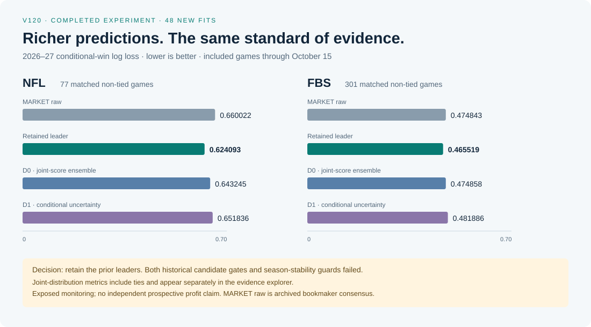

<p align="center"></p>

NFL and FBS forecasting built around a difficult engineering question: can a model add information beyond the market, and can every result survive an audit?

Designed and implemented by [Alvaro Mendizabal](https://github.com/alvaromendizabal). The project connects source acquisition, information-time contracts, four native ML frameworks, chronological experiments, immutable forecasts and recoverable AWS execution. NFL, FBS, NBA and NCAA basketball maintain separate model evaluations while sharing provenance, recovery and data infrastructure.

[Start the review](docs/REVIEW_GUIDE.md) · [Current evidence](docs/CURRENT_EVIDENCE.md) · [Model card](docs/MODEL_CARD_CURRENT.md) · [System design](docs/SYSTEM_DESIGN.md) · [Run the example](examples/review_lab/README.md)

Latest published football execution, October 26: V120 completed 48 joint-distribution fits and a 240-cell comparison after 1,278 owner checks passed. Both historical candidate gates and both season-stability guards failed; stronger retained references remain in place. The [score-distribution case study](docs/CASE_STUDY_SCORE_DISTRIBUTIONS.md) follows the mechanism from coherent probabilities to an honest negative decision. The earlier [joint-feature experiment](docs/CASE_STUDY_JOINT_EVIDENCE.md) and [source failure and recovery](docs/CASE_STUDY_PROVENANCE.md) remain preserved.

Basketball status, October 27: B003 completed controlled opponent-adjustment experiments with 60 new native estimator units and 156 exact predecessor reuses, bringing the cumulative basketball total to 232. Rich regularized models improved both college historical seasons; NBA retained its previous strength model. Larger matched sportsbook cohorts still establish no qualified MARKET advantage. The [basketball study](docs/BASKETBALL_FOUNDATION.md), [generated league leaderboards](docs/BASKETBALL_RESULTS.md), [model card](docs/BASKETBALL_MODEL_CARD.md) and [executed notebook](notebooks/basketball_review.ipynb) expose both gains and calibration weaknesses. Prior forecasts remain immutable; all 61 upcoming games still lack settled prospective scores at the audited snapshot. B001's failure is preserved. [B004 subsequently executed and stopped at the public-request ceiling](docs/BASKETBALL_B004_EXECUTION.md): six new correction units bring basketball to 238, with no promoted challenger. B003 remains the latest fully completed real modeling release.

## A five-minute technical review

| Inspect | What it demonstrates |
|---|---|
| [Credential-free ML example](examples/review_lab/README.md) | Real fitting on invented data, chronological separation, exact-cohort scoring, leakage rejection and zero-fit reentry |
| [Basketball study and public checks](docs/BASKETBALL_FOUNDATION.md) | Audited real season aggregates, separate league leaderboards and executable identity/time contracts using invented fixtures |
| [Executed review notebook](notebooks/engineering_review.ipynb) | Reproducible synthetic results beside clearly separated, sanitized real-run aggregate evidence |
| [Current evidence export](docs/evidence/2026-10-26-v120.json) | Three campaigns, multiple training origins, raw MARKET, controls, all four frameworks and retained references |
| [System design](docs/SYSTEM_DESIGN.md) | Data/model/decision contracts, lineage, failure states and recovery |
| [Published scientific implementations](docs/PROJECT_SCOPE.md) | Preserved fitting, source-adjudication, uncertainty and interruption tests from earlier research stages |
| [Joint-score case study](docs/CASE_STUDY_SCORE_DISTRIBUTIONS.md) | Normalized probability laws, ties, proper scores, log-space stability and a completed negative experiment |
| [Joint-feature case study](docs/CASE_STUDY_JOINT_EVIDENCE.md) | Factorial complementarity, paired uncertainty, exact cohorts and a preserved negative decision |
| [Failure-to-recovery case study](docs/CASE_STUDY_PROVENANCE.md) | Multi-parent provenance, content-pinned relocation, rejection tests and honest incident classification |

<p align="center"></p>

The graphic above is generated from the same aggregate export as the [evidence explorer](docs/review/index.html). Download and open that self-contained HTML file locally; GitHub's file viewer displays its source. It has four synchronized tables, sport/campaign selectors, separate binary and joint proper scores, paired interaction evidence, feature-family explanations and no external requests.

## Current evidence, with the boundaries attached

The October 26, 2026 publication incorporates completed V120 joint-distribution modeling, event identity repairs and current research issuance. It preserves negative results and distinguishes predictive scores from economic outcomes.

| 2026–27 monitoring cohort | Games | MARKET raw log loss | D0 ensemble | D1 ensemble | Retained leader |
|---|---:|---:|---:|---:|---:|
| NFL | 77 | 0.660022 | 0.643245 | 0.651836 | **0.624093** |
| FBS | 301 | 0.474843 | 0.474858 | 0.481886 | **0.465519** |

Lower is better. These are matched, non-tied games with included kickoffs through October 15, not complete seasons. Retained references were selected on exposed outcomes. The new challenger failed both historical qualification gates; the NFL monitoring panel has only six weekly blocks. These results do not establish prospective profitability.

[All 2024–25, 2025–26 and 2026–27 comparisons](docs/CURRENT_EVIDENCE.md) include Brier scores, different update policies and separate metric-specific references. MARKET means archived bookmaker consensus after paired de-vig—not an executable quote, a closing line, or Kalshi.

## What the completed owner run established

| V120 owner result | Verified outcome |
|---|---|
| Verification | 1,278 tests passed; 3,342 binary and 112 distribution scorecards independently rescored |
| Model comparison | 240 cells: 48 new PyTorch/TensorFlow fits + 192 retained comparisons |
| Scientific decision | Both historical candidate and season-stability gates failed; no automatic promotion |
| Current research issuance | 4,749 model rows across 69 priced games; rows are not independent games |
| Event admission | 69/77 incoming price events admitted; seven identity and one book-coverage rejection preserved |
| Action admission | Zero paper actions and zero actual wagers; stale source quotes kept gates closed |

The new capability is a coherent joint score distribution. Passing probability checks does not imply better forecasts, and better forecast metrics alone do not establish executable value. The public example now includes a generic distribution evaluator with invented inputs and adversarial numerical tests.

## Engineering decisions worth inspecting

- Keep publication, observation, revision, label availability and decision clocks distinct.
- Fit preprocessing and learned representations inside their chronological training boundaries.
- Compare new systems with raw MARKET, matched controls and the strongest retained references on identical games.
- Preserve source bytes, model identity and accepted forecasts through recovery.
- Separate successful execution from positive science and deployment readiness.
- Validate source, environment, notebooks and resource guards before expensive owner work.

[Architecture and trade-offs](docs/SYSTEM_DESIGN.md) · [Research protocol](docs/RESEARCH_PROTOCOL.md) · [Current data gaps](docs/CURRENT_EVIDENCE.md#data-and-serving-outcomes)

## Reproduce the public review

Python 3.11+; no credentials, cloud account or third-party packages are required for the core example. Run from the repository root:

```bash
python -m unittest discover -s examples/review_lab/tests -v
python -m examples.review_lab --output /tmp/sports-edge-review
python -m examples.review_lab --output /tmp/sports-edge-review
python -m examples.review_lab.build_review --check
python -m examples.review_lab.provenance
python -m examples.review_lab.factorial
python -m examples.review_lab.distribution
```

The second invocation verifies and reuses the accepted synthetic report with zero new fits. A different seed, changed implementation or corrupted artifact is rejected. The optional notebook uses Jupyter; see its [environment and reproduction instructions](examples/review_lab/README.md).

The public-review workflow runs the synthetic suite on Python 3.11/3.12, checks selector behavior, and executes the notebook in a separate kernel with saved-output validation. It complements the retained [scientific modeling](.github/workflows/modeling-quality.yml), [acquisition guards](.github/workflows/ingestion-guards.yml) and [repository hygiene](.github/workflows/repository-hygiene.yml) workflows. Consult the actual Actions result for the published commit. Earlier implementations and dated evidence remain intact.

## Public code, private research assets

Public material includes source contracts, evaluation mechanics, synthetic fitting, tests, notebooks, architecture and aggregate research results. Licensed/raw observations, individual forecasts, trained production weights, exact active feature transformations, tuning and live decision configuration remain private. The synthetic example verifies engineering behavior; it does not reproduce the private football scores.

[Publication boundary](docs/PUBLICATION_BOUNDARY.md) · [Historical evidence and maintained paths](docs/PROJECT_SCOPE.md) · [Evidence-based repository review](docs/REPOSITORY_REVIEW.md)
