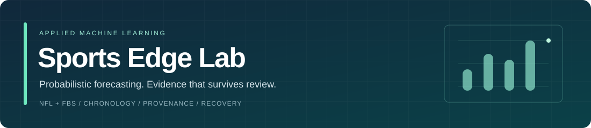
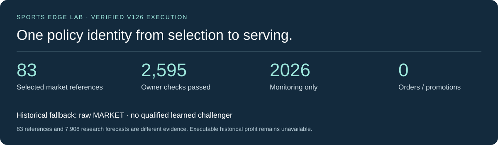

## NCAA V10 recovery — November 13, 2026

[Open the live NCAA dashboard](https://alvaro-ncaa-research-review.alv-mendizabal.chatgpt.site) · [Versioned dashboard source](docs/ncaa/v10.html)

Phase A recomputed 854,308 eligible saved prediction rows across 18 competition/season/target partitions, producing 336 separate scorecards and 64 metric-specific descriptive leader rows. The page contains 25,847 recovered game/time records across men's and women's 2024–25, 2025–26 and 2026–27 evidence. Original source clocks, smaller cohorts, missing provider matches and negative findings remain visible. These archived observations do not certify a fresh complete current season or upcoming schedule. No new scientific model fits, inference, issued forecasts or promotions are claimed. The local leased-process benchmark was blocked by unverifiable CPU-pressure evidence; twelve-core SageMaker acceptance remains pending.

The existing public NCAA site is deployed; this repository's GitHub Pages service remains disabled. The saved-model original/former/current/frozen-role registry is preserved privately, and an unresolved role binding is not reassigned from current outcomes.

---

<!-- NCAA_B063R9_ROOT_STATUS_START -->
## NCAA basketball B063R9 — November 13, 2026 UTC

[Current NCAA repository dashboard](docs/ncaa/index.html) · [Actual R8 failure and verified R9 preparation](docs/ncaa/b063r9.html)

**Latest authenticated owner result: B063R8 failed before scientific workers started, with zero new fits.** The schedule provenance check rejected authenticated cached bytes. Peak reserved capacity remained one CPU; the twelve-core scientific queue was never reached. The return records 118 verified local reads, 1,396,887,267 reused bytes and regular live logging.

**B063R9 is prepared and verified:** 758 unique packaged engineering cases passed, and all eight scientific identities remain unchanged from R8. The repair preserves earlier game rows, model metrics, checkpoints and original issue clocks. Engineering tests earn no new sports-fit credit.

R9 owner execution, complete current-season and upcoming-game refresh, and measured twelve-core scientific acceptance remain pending. The linked repository pages show the actual failure, repair evidence, retained metric leaders and explicit coverage gaps.

**The separately hosted NCAA site has not been redeployed by this update.** Repository publication and hosted browser tests are separate from website deployment. The dated historical reports and other sports' updates below remain preserved.

<!-- NCAA_B063R9_ROOT_STATUS_END -->

## NCAA basketball B062: execution repaired, earlier models retained — November 11, 2026 UTC

**B060 remains the latest actual owner run; B062 is prepared and locally validated.** B061's reported launch stopped before archive code. The new continuation provides measured source diagnostics, earlier durable fit output, a native-library startup fix, fourteen separate metric roles, and lossless authenticated return splitting. The original checkpoint authority and seven older scientific identities are preserved. Actual twelve-core throughput and fresh future forecasts still require the next owner execution.

The preserved current-season frozen replay reports **men: 0.394807 log loss, 337/415 correct; women: 0.318015, 340/399 correct**. These are exposed reconstructions. The latest saved exports retain **814 completed-game replay triplets**, **30 matched original-issue triplets**, two unscored original issues and six preserved selected roles. All 1,139 unissued future previews stay blank. The 3,457-record inventory is not a certified unique-game denominator.

[B062 findings and execution evidence](examples/ncaa_review/B062_EVIDENCE.md) · [Machine-readable status](examples/ncaa_review/B062_STATUS.json) · [Reconstruct the executed notebook and interactive report](examples/ncaa_review/B062_SAVED_REPORTS.md) · [Preserved issued forecasts](examples/ncaa_review/data/ncaa_preserved_selected_issues_scored_b061.json) · [Saved selected roles](examples/ncaa_review/data/ncaa_metric_role_status_b061.json)

No new promotion, fresh provider comparison, owner training result or website deployment is implied. Earlier dated evidence below remains preserved.

## NCAA basketball: frozen model recovered and prior forecasts scored — November 11, 2026 UTC

The preserved original frozen reference now has authenticated current-season replay scores: **men 0.394807 log loss and 337/415 correct winners (81.20%); women 0.318015 and 340/399 (85.21%)**. Its original weights are unchanged. These are exposed retrospective reconstructions, with independent official-final and historical publication-vintage qualification still unresolved. The improvement over an earlier smaller saved cohort is not a newly trained model improvement.

**90 of 96 previously published target outputs now have matched observed outcomes, covering 30 of 32 games.** Original issue values and clocks are preserved. On those same games the selected original issues have lower log loss than the frozen replay in both leagues; two men’s games with changed recorded tip times remain unscored. No new promotion or fresh future issue is claimed.

[Interactive B061 evidence and game census](examples/ncaa_review/B061_EVIDENCE_REPORT.html) · [Scientific results and qualifications](examples/ncaa_review/evidence/B060_ACTUAL_B061_PREPARED.md) · [All observed records CSV](examples/ncaa_review/data/ncaa_observed_games_b060.csv) · [Latest saved metric roles and missing roles](examples/ncaa_review/data/ncaa_metric_role_status_b061.json)

The census contains **3,457 source records**, including unmatched candidates; it is not a certified complete-game universe. Public values include completed frozen replays and preserved selected issues. The **1,139 unissued future replay previews stay blank**. Current Kalshi/DraftKings/Polymarket performance comparisons remain unavailable pending exact same-game, cutoff and product matching.

The actual B060 owner run preserved work before a coordination failure after **2h 15m 02s**, averaging approximately **0.62 CPU cores**. B061 prepares atomic lease/affinity handling, bounded concurrent league work, source reuse and earlier durable reporting. Owner execution, twelve-core throughput and fresh next-game coverage remain pending. Earlier dated records below retain their original scope.

## NCAA: selected prior forecasts recovered — November 11, 2026 UTC

The authenticated archive now supplies **96 preserved selected target forecasts for 32 games (18 men’s and 14 women’s)**, covering home-win probability, home-minus-away margin and total points. The six saved historical selections determine the exported roles; the latest eligible original issue is retained without consulting current outcomes. Three additional games in the wider issued archive have no matching selected-role issue and receive no substitute.

[Preserved selected forecasts and qualifications](examples/ncaa_review/evidence/B059_PRESERVED_SELECTED_ISSUES.md) · [CSV](examples/ncaa_review/data/ncaa_preserved_selected_issues_b059.csv) · [JSON](examples/ncaa_review/data/ncaa_preserved_selected_issues_b059.json)

These are actual earlier issues for games scheduled November 6–10, with original clocks and ordered ESPN team IDs. They are separate from the unmatched official-game inventory, newly issued upcoming forecasts and freshly qualified current champions. No original B003 issue, outcome join, new model fit, fresh performance score or promotion is claimed. Earlier dated evidence remains below.

## NCAA basketball: actual B059 recovered; B060 prepared

The latest authenticated NCAA owner run completed **107 target fits, 17 calibrations and 36 residual fits**, then stopped on an I/O deferral after **2 hours 11 minutes 36 seconds**. Although its project ceiling was twelve CPUs, measured CPU usage averaged approximately **0.81 cores**. B060 fixes the serial admission paths, coordinates atomic NCAA/FBS leases, preserves the completed work, prioritizes selected forecasts, and expands the finite full-model and ablation tranches. Actual B060 owner execution and measured throughput remain pending.

The saved approximately **0.40 log-loss** model evidence is preserved. It has not been replaced by weak standalone controls or freshly rescored by this engineering update. No new promotion is claimed.

[Actual B059 evidence and prepared B060 changes](examples/ncaa_review/evidence/B059_ACTUAL_B060_PREPARED.md) · [All 2,512 supplied official game records and explicit forecast gaps](examples/ncaa_review/data/ncaa_observed_games_b059.csv) · [Men](tracks/ncaam/README.md) · [Women](tracks/ncaaw/README.md)

The observed game report retains its original time. Its canonical source stream was empty, so all selected forecast fields remain unavailable; seven date gaps also prevent a complete-season claim. The source repair permits one authenticated recovery from an inherited ESPN timeout while preserving provider rate-limit refusals. Earlier dated updates below remain historical.

## NCAA basketball: actual B058, V7 continuation prepared

The latest authenticated owner return preserved **90 new target fits** and **seven exact prior frozen-fit reuses** before its work budget ended. It completed 65 of 6,216 core contexts and 25 of 14,544 scalar contexts; those context totals are not model-fit counts. It issued **zero new current forecasts** and promoted **zero models**. The older research, including stronger complete-model scorecards, remains preserved.

The prepared V7 continuation prioritizes current forecasts, restores exact old fits, compares a bounded set of metric-specific contenders, and runs independent work under a shared CPU/memory coordinator. It returns at bounded work checkpoints instead of requiring the entire nominal frontier first. Local regression tests establish software behavior; actual owner throughput and new model results remain pending.

[Authenticated B058 evidence and prepared V7 limits](examples/ncaa_review/evidence/B058_ACTUAL_B059_PREPARED.md) · [Men’s evidence](tracks/ncaam/README.md) · [Women’s evidence](tracks/ncaaw/README.md)

<p align="center"></p>

## FBS engineering continuation — November 10, 2026 UTC

**V055 prepared; latest actual owner remains V053.** The continuation addresses complete comparisons across bounded pages, preserving early-page candidates and resuming beyond completed work. A credential-free example uses invented inputs and passes 12 focused tests; it establishes no new FBS result or AWS speed claim. The saved all-game report and its 500 issue contexts across 122 games remain unchanged. [Engineering note and limitations](docs/fbs/PAGED_COMPARISON_2026-11-10.md) · [Current FBS evidence](docs/fbs/current.html).

## FBS update — November 10, 2026 UTC

**NCAA FBS — authenticated V053 partial results; V054 prepared.** The latest owner completed three base fits and six mixture fits, preserving 256 new issue records and 768 current scalar outputs. Legacy recovery continued for approximately 130 minutes before console-control exhaustion interrupted reporting; the partial return is authenticated, and the complete workload remains unfinished. The public game report distinguishes 500 saved issue records from 122 unique games, preserves original forecasts separately from later revisions, and retains negative findings from the 211-game mixture comparison. V054 prepares broad frozen 2024/2025 comparisons, metric-specific champions and rolling retraining only for selected champions; new owner execution is pending. [FBS evidence and limitations](docs/fbs/README.md) · [All-game analytical view](docs/fbs/current.html).


# Forecasts you can interrogate

**Sports Edge Lab** connects probabilistic sports modeling with reliable ML infrastructure: chronological training, immutable forecasts, matched market comparisons and recoverable cloud execution. Built by [Alvaro Mendizabal](https://github.com/alvaromendizabal).

[**Latest NFL V10 all-game research view →**](tracks/nfl/dashboard_n088/index.html) · [Current NFL evidence](tracks/nfl/README.md) · [Dated hosted NFL snapshot](https://sports-edge-lab-nfl.alv-mendizabal.chatgpt.site/) (separate publication; not refreshed here) · [Five-minute technical review](docs/REVIEW_GUIDE.md) · [System design](docs/SYSTEM_DESIGN.md) · [Reproducibility boundary](docs/PUBLICATION_BOUNDARY.md)

[**Open the FBS browser dashboard →**](https://sports-edge-lab-fbs.alv-mendizabal.chatgpt.site) · [FBS clock and coverage methodology](docs/fbs/SEASON_EXPLORER_2026-11-03.md) · [FBS source and model card](tracks/ncaaf/README.md)

## NFL V10 recovery · November 13, 2026 UTC

[Prepared N088 interactive source](tracks/nfl/dashboard_n088/index.html) · [Current NFL evidence](tracks/nfl/README.md) · [Fresh public Phase A scorecards](tracks/nfl/phase_a_n088_public.json)

**171 saved-model scorecards / 10,216 model–game rows recomputed; zero new fits.** All 272 games remain visible: 137 finals, 111 confirmed upcoming and 24 kickoff TBD. Current union coverage is 136 non-tied winner and 137 point outcomes across models; largest single-model cohorts are only 119 / 120, leaving at least 17 missing outcomes. This is partial recovery, not full-season champion acceptance. Original issues, later-fitted reconstructions and exact-cohort leaders remain separate; no promotion or provider advantage is claimed.

**The actual N087 owner run failed** after 678.674 seconds at 0.399 mean CPU cores. Both live logs and the return closure succeeded, but all three scientific children exited without responses. A cold-import recursion defect is independently reproduced in the exact packaged executable. Fifteen paid calls occurred; zero completed new scientific receipts were verified.

**Online deployment remains pending verification.** The existing hosted NFL Site was still the November 9 N063 publication, explaining why later GitHub source updates were not visible online. The prepared N088 package uses paged games, lazy historical scorecards and script-free fallback tables; the same public URL will be updated after validation.

## Preserved NFL N085 / N086 evidence · November 13, 2026 Pacific

**Latest N086 execution failed:** 564.544 seconds, 0.397 mean CPU cores, 15 paid calls and no completed new scientific receipt. Final fit/forecast counts are unknown; zero observed optimizer callbacks are a separate measurement. [Failure evidence](tracks/nfl/2026-11-13-n086-failed-n087-review.json) · [Failure panel](tracks/nfl/season_review_n086.html#latest-execution). N087 repair work is separate; all N085 forecast clocks and scientific results below are preserved.

**The actual N085 executable completed 327 verified new fits: 294 native and 33 meta.** All 78 planned historical candidates completed 234 frozen fits and 156 annual scorecards. The current-season monitor performed 60 new fits and reused 168 predictions. All 180 prior historical fit identities remain preserved. Owner acceptance is still incomplete: the original forward runtime, cohort-identity checks and full comparable coverage remain unresolved.

The [latest NFL all-game research view](tracks/nfl/season_review_n086.html) shows **all 272 games: 137 finals, 111 timed upcoming and 24 kickoff TBD**, with **444 latest selected outputs** at the saved November 13, 09:53:20 Pacific cutoff. It exposes 783 current-season monitoring cards, 63 selected replay cards, all 1,530 historical cards, and separately dated former/original champion evidence. [Model card](tracks/nfl/CURRENT_MODEL_CARD.md) · [Exact aggregate evidence](tracks/nfl/2026-11-13-n085-actual-n086-review.json) · [Prior scientific snapshot](tracks/nfl/season_review_n084.html).

Seven genuine historical optimizer calls overlapped, but whole-invocation CPU use averaged only **0.858 core equivalents over 45.236 minutes**. Sustained twelve-core utilization and matched speedup remain unproved. Live logs continued with a maximum observed heartbeat gap of 13.347 seconds. None of the new candidates displaced the nine primary historical metric roles. Current-season replay leaders are displayed only on their exact cohorts, with missing finals explicit; no rolling production promotion, fabricated provider comparison or live-site deployment is claimed.

<details>
<summary>Preserved N076 NFL evidence · dated November 12 snapshot</summary>

## Preserved N076 evidence · November 12, 2026

**N076 made substantive but incomplete progress: 62 new fits and 1,008 unique issue events across 112 future games in 2 hours 43 minutes.** The [dated all-game research view](tracks/nfl/season_review_n077.html) publishes **448 selected forecasts for all 112 timed future games**, retains all **272 season games** and preserves earlier issues/reconstructions in separate panels. The final selected cutoff is November 12, 03:52:38 UTC; 24 kickoff times remain TBD.

The [current model card](tracks/nfl/CURRENT_MODEL_CARD.md) preserves separate 2024/2025 metric leaders and former champions. Core source, replay-accounting, original-runtime and monitoring failures still block a complete current-season champion refresh. The reconciled early-snapshot panel covers **15 games, not 135 games**; no independent promotion is established. Captured DraftKings, Kalshi and Polymarket evidence is disclosed separately from zero newly admitted benchmark cells. [Actual execution evidence](tracks/nfl/2026-11-12-n076-actual-n077-review.json).

</details>

<details>
<summary>Preserved November 8 NFL evidence</summary>

## Current NFL evidence · November 8, 2026

**All 272 games and 32 teams are accounted for.** The latest authenticated NFL owner snapshot has **130 finals, 129 decisive results and one tie**, plus **three in progress, one at halftime and 138 scheduled**. Earlier snapshots remain preserved. CHI 34–SEA 17, JAX 33–BAL 10 and CIN 34–ATL 17 are present. Historical `LA` identifies the Rams; `LAC` identifies the Chargers.

**Actual N058 is partial: 27 new native states and 2,286 actual issue rows completed.** The refreshed football arrays include the exact eight-game causal append. Selected configurations produced three current-origin outputs for each of the 138 then-scheduled games. Long-range outlooks stay separately qualified and have no validated long-horizon accuracy. Original aggregate fit/native/meta counters remain null; verified component counts are separate.

The complete private report has **128 dated roles, 104,448 model cells, 46,512 equal-provider cells across 19 horizons and 1,214 seasonal metrics**, plus complete historical predictions and comparisons. It opens on the earliest authenticated scheduled issue and includes 426 next-action target records. The public dashboard uses the strict allowlist: all-game coverage, equal provider status, anonymous aggregates and eight bounded already-issued examples. [Public scope and preservation](tracks/nfl/PUBLIC_BOUNDARY_N059.md).

The original selected-control 2026 scores remain winner log loss 0.6551848900 on 119 games, margin MAE 9.9167425287 on 120 and total MAE 11.3714075322 on 120. All three primary paired intervals include zero. Negative and adverse findings remain preserved; **no model is promoted**.

The latest bounded source capture has **7,125 normalized observations, 78 observed representative target cells and 1,780 alternate conditions**. Kalshi and Polymarket restored references cover all 130 current finals in their distinct source-time horizon. Protected 120/119 benchmarks, original Polymarket 92/91 timed support, common119 provider and exact91 model comparisons remain unchanged. Later recovery earns zero predictive credit.

**N058 V4 historical preparation failed before fitting at a safe-file boundary. N059 repairs that exact boundary and remains prepared.** It preserves recent completed-season selection, earlier-only per-cutoff fitting, train-only transformations, genuine OOF meta layers and exact checkpoint reuse. The retained 211-candidate/159-extractor registry receives no new owner admission or evaluation credit.

[Complete NFL evidence](tracks/nfl/README.md) · [Open interactive dashboard](https://sports-edge-lab-nfl.alv-mendizabal.chatgpt.site/) · [Bounded offline public HTML](tracks/nfl/season_review_n054.html)

The Site is a dated publication of an exact canonical commit. Publication requires exact PR-head CI, a permitted merge, final-main readbacks and deployment/content verification. Active NFL presentation is research-only.

</details>

## Review the work in five minutes

| Time | Inspect | Evidence of capability |
|---|---|---|
| 1 minute | [Current NFL results](tracks/nfl/README.md) | Proper scoring, honest denominators, both winning and losing disagreements |
| 1 minute | [Current model card](tracks/nfl/CURRENT_MODEL_CARD.md) | Model/feature families, selection boundaries, update policy and failure modes |
| 2 minutes | Run the three commands below | Exact-cohort evaluation, paired uncertainty, calibration, meaningful negative tests |
| 1 minute | [System design](docs/SYSTEM_DESIGN.md) and [recovery case study](docs/RECOVERABLE_OPERATIONS.md) | Lineage, immutable receipts, bounded recovery and honest reuse accounting |

```bash
python tracks/nfl/paired_evaluation.py --demo
python -m unittest discover -s tracks/nfl -p 'test_*.py'
python tracks/nfl/contracts.py --check-review
```

Python 3.11+; no credentials, data subscriptions or cloud account. The demonstration uses **invented inputs** and does not reproduce real football accuracy. [The broader synthetic fitting example](examples/review_lab/README.md) and [executed notebook](notebooks/engineering_review.ipynb) expose training and recovery mechanisms. Public result aggregates are inspectable; full private-model retraining requires withheld source snapshots and research assets.

## Engineering choices worth reviewing

- **Information time is enforced:** source, label, fit and forecast clocks have separate contracts.
- **Experiments retain failures:** feature interactions and ensembles are evaluated alongside original controls; unsuccessful arms remain visible.
- **Evaluation is paired:** event identities, horizons and settlement definitions must agree before metrics are compared.
- **Operations survive interruption:** committed bodies and receipts are authenticated before reuse; restored work is never counted as a new fit.
- **Publication has a boundary:** generic methods, sanitized resolved examples and selected rounded early research cards are public; licensed feeds, active recipes, weights and credentials remain private.

For ML engineering roles, follow [recovery](docs/RECOVERABLE_OPERATIONS.md), [serving lineage](docs/CASE_STUDY_SERVING_LINEAGE.md) and the tests. For data science, inspect [matched uncertainty](tracks/nfl/paired_evaluation.py), calibration and negative findings. For AI engineering, the evidence here is dependable model orchestration and evaluation; this repository does not claim an implemented LLM/RAG product.

## NCAA basketball update · November 6, 2026 UTC

**B043 preserved baseline reporting before its injury-checkpoint failure.** Nine
of sixteen stages completed, with 101 new target fits, 45 scalar calibrators and
24 empirical fits. The recovered private report retains 84,195 target rows and
46,529 browser rows; independent arithmetic reconciles 944 metric panels with
zero mismatches. B043 issued no new qualifying forecasts, while 339 earlier
issue rows across five games remain preserved and unscored.

A new 129-game men's Polymarket international comparison gives the original
reconstruction higher winner accuracy (86.05% versus 82.17%) but worse log loss
(0.3444 versus 0.3212). This is reconstructed evidence, with no established
betting advantage. The dated 122-game comparison and historical selections remain
unchanged. Injury and market-path research are still incomplete; B044 prepares
a narrow missing-clock checkpoint repair.

[Open the NCAA dashboards](https://alvaro-ncaa-research-review.alv-mendizabal.chatgpt.site/)
· [Men's evidence](tracks/ncaam/README.md) · [Women's evidence](tracks/ncaaw/README.md)
· [Methods and reproducible contracts](examples/ncaa_review/README.md)

## Separate projects, shared engineering

| Track | Entry point | Publication boundary |
|---|---|---|
| NFL | [V10 all-game view](tracks/nfl/dashboard_n088/index.html) · [Current evidence](tracks/nfl/README.md) | N088 Phase A: 171 recomputed cards, 10,216 scored rows, zero new fits. N087 actual owner run failed. All 272 games and 444 original selected outputs preserved; full single-model season coverage and provider comparisons incomplete. Online deployment verification pending. |
| NCAA FBS | [Browser dashboard](https://sports-edge-lab-fbs.alv-mendizabal.chatgpt.site) · [Track](tracks/ncaaf/README.md) | Actual V053 partial; V055 prepared; 500 saved issue contexts across 122 games, with dated provider coverage |
| NBA | [Research view](docs/NBA_RESEARCH_CARD.md) | Separately dated basketball evidence |
| NCAA basketball | [Open dashboards](https://alvaro-ncaa-research-review.alv-mendizabal.chatgpt.site/) · [Men's evidence](tracks/ncaam/README.md) · [Women's evidence](tracks/ncaaw/README.md) · [Runnable contracts](examples/ncaa_review/README.md) | Separate historical selections, current execution gaps and three-provider qualification |

Each track has its own scientific ownership and update history. Shared infrastructure and navigation changes are coordinated through a scoped PR. [Contribution and ownership rules](CONTRIBUTING.md) · [Security](SECURITY.md) · [Public-use scope](docs/PUBLICATION_BOUNDARY.md)

<details>
<summary><strong>Preserved project history and earlier review routes</strong> — dated evidence, not the latest NFL status</summary>


NFL and FBS forecasting built around a difficult engineering question: can a model add information beyond the market, and can every result survive an audit?

Designed and implemented by [Alvaro Mendizabal](https://github.com/alvaromendizabal). The project connects source acquisition, information-time contracts, native ML frameworks, chronological experiments, immutable forecasts and recoverable AWS execution. NFL, FBS, NBA and NCAA basketball maintain separate model evaluations while sharing provenance, recovery and data infrastructure.

[Results dashboard](docs/dashboard/index.html) · [Start the review](docs/REVIEW_GUIDE.md) · [Current explorer](docs/current/index.html) · [Current evidence](docs/CURRENT_EVIDENCE.md) · [Model card](docs/MODEL_CARD_CURRENT.md) · [System design](docs/SYSTEM_DESIGN.md) · [Run the example](examples/review_lab/README.md)

NFL owner branch, October 29: the [NFL evidence review](tracks/nfl/README.md) accounts for 7,549 game identities and explains why the complete 2024/2025 seasons contain 285 games while the saved model cohorts contain 280/277. Its [interactive comparison](tracks/nfl/review.html) exposes 316 audited model/market tables and a credential-free reconciliation example. N007's coordinator-admission failure is preserved; N006 remains the latest successful owner execution in that branch, MARKET remains accepted, and N008 owner research is pending.

Latest completed football execution, October 28: [V134 completed all twelve registered extension fits in twelve attempts](docs/evidence/2026-10-28-v134-execution.json), restored financial reporting, and verified every declared emitted stage output. The combined study now contains 36 completed units across 38 attempts, preserving both earlier failures. All four extension qualification gates failed; the operational policy remains MARKET.

V134 issued 89 timestamped MARKET references, covering all 68 remaining current-week games. Its edge-qualified portfolio retained $500 as cash, with zero qualified executions, fills or orders. Inherited conditional +$2.40 still equals MARKET and is not realized profit. [The completion study](docs/V134_COMPLETION_AND_SHARED_INVENTORY.md) connects the [earlier V133 recovery failure](docs/PORTABLE_RECOVERY_INCIDENT.md), the verified correction and measured throughput costs. The [dashboard](docs/dashboard/index.html) preserves earlier scorecards under their original vintages. A new [shared-inventory example](examples/review_lab/shared_inventory.py) deduplicates three invented project scopes without turning missing inventory into permission to buy data. V135 owner execution remains pending.

The new [recoverable operations example](docs/RECOVERABLE_OPERATIONS.md) persists eight independent stage contracts on invented inputs. It preserves forecasts and financial artifacts when research fails, retries only unfinished work, rejects changed identities and corrupt receipts, and reenters with zero new stage attempts after completion.

Earlier completed football research, V129: [V129 completed 24 constrained ensemble fits and passed 2,856 owner checks](docs/evidence/2026-10-28-v129-execution.json). Independent saved-output rescoring verified 2,046 probability scorecards and 32 matched MARKET intervals. All four historical league/protocol qualification gates failed, so operational forecasts retain the sportsbook MARKET fallback. The [new study note](docs/CONSTRAINED_ENSEMBLE_FINDINGS.md) explains the small NFL 2024 gain, the 2025 reversal and why training safeguards did not establish heldout superiority. No promotion, order or realized profit is claimed.

The [retained V125 aggregate export](docs/evidence/2026-10-27-v125.json) preserves 9,756 model scorecard views, 180 paired expert comparisons and 1,586 venue diagnostics. Counts describe aggregate records, not unique games or independent tests.
The new [historical-selection contract](docs/HISTORICAL_SELECTION_BOUNDARY.md) reserves 2026–2027 for monitoring. Current-season outcomes cannot choose a champion, calibration method, feature set, ensemble or staking policy. The public example demonstrates how that boundary survives a forward-season apparent winner and how a frozen, outcome-free paper decision is settled separately.

<p align="center"></p>

Basketball status, October 27: B003 completed controlled opponent-adjustment experiments with 60 new native estimator units and 156 exact predecessor reuses, bringing the cumulative basketball total to 232. Rich regularized models improved both college historical seasons; NBA retained its previous strength model. Larger matched sportsbook cohorts still establish no qualified MARKET advantage. The [basketball study](docs/BASKETBALL_FOUNDATION.md), [generated league leaderboards](docs/BASKETBALL_RESULTS.md), [model card](docs/BASKETBALL_MODEL_CARD.md) and [executed notebook](notebooks/basketball_review.ipynb) expose both gains and calibration weaknesses. Prior forecasts remain immutable; all 61 upcoming games still lack settled prospective scores at the audited snapshot. B001's failure is preserved. [B004 subsequently executed and stopped at the public-request ceiling](docs/BASKETBALL_B004_EXECUTION.md): six new correction units bring basketball to 238, with no promoted challenger. B003 remains the latest fully completed real modeling release. B005 subsequently completed zero-fit evidence recovery. The [new MARKET-coverage study](docs/BASKETBALL_MARKET_COVERAGE.md) and [executed cohort notebook](notebooks/basketball_market_coverage.ipynb) correct the pooled-season comparison: baseline-probability matching leaves the NCAA men gap, while month-aware matching reduces it with substantial uncovered-support loss. This descriptive result establishes no independent MARKET advantage or new budget authority. B006 has now completed authenticated saved-evidence analysis with zero new fits. The [basketball evidence dashboard](docs/basketball/index.html) exposes 235 saved scorecards, historical overlap and monitoring boundaries; the [feature-release contract](docs/BASKETBALL_FEATURE_RELEASE.md) and [executed notebook](notebooks/basketball_feature_release.ipynb) demonstrate cutoff-safe revisions and immutable feature snapshots on invented data.

B007 completed authenticated saved-evidence recovery with zero new fits, requests or forecasts. [B008 then executed and returned BLOCKED_DATA_CONTRACT](docs/BASKETBALL_B008_EXECUTION.md): zero new fits, zero paid requests or provider credits, and 110 additional immutable forecast versions for the same 61 games. The archive now contains 440 versions, none settled; cumulative real basketball units remain 238. A shared preflight prevented eligible folds from being reached, while incomplete archive inventory blocked acquisition. The [B009 continuation example](examples/basketball_contracts/continuation.py) isolates support failures, retains the original authorization and counter baseline, and keeps unresolved request charges across restart. The [recovery contract](docs/HISTORICAL_ODDS_RECOVERY.md) now attaches inventory, request and response provenance to every gap. These invented examples make no requests or fits. The [authenticated NBA follow-up](docs/NBA_RESEARCH_CARD.md) now records 10 new B009 NBA units, 85 lifetime NBA units and 268 combined basketball units; no NBA challenger was promoted and no qualified MARKET advantage was established. The [NBA research view](docs/nba/index.html) presents the registered feature/window comparison and executable branch contracts. B010-NBA real research remains pending.

## A five-minute technical review

| Inspect | What it demonstrates |
|---|---|
| [NFL owner evidence and reconciliation](tracks/nfl/README.md) | Full-season denominators, exact-cohort market comparisons, exposed monitoring and a coordinator-admission failure with runnable public contracts |
| [Shared archive federation](docs/V134_COMPLETION_AND_SHARED_INVENTORY.md) | Complete declared scope, byte and semantic deduplication, original request receipts, cutoff admission and no implicit spend authority |
| [Recoverable operations journal](docs/RECOVERABLE_OPERATIONS.md) | Atomic immutable receipts, input/dependency identity, bounded attempts, interrupted-publication recovery and zero-work reentry |
| [Results and execution dashboard](docs/dashboard/index.html) | Actual failure, exact historical panels, monitoring vintage and an interactive fault-isolation demonstration |
| [Credential-free ML example](examples/review_lab/README.md) | Real fitting on invented data, chronological separation, exact-cohort scoring and zero-fit reentry |
| [Executed review notebook](notebooks/engineering_review.ipynb) | Synthetic mechanisms beside separately validated owner-run aggregates and actual V126 serving lineage |
| [Exact-panel explorer](docs/current/index.html) | 57 league / protocol / origin / target panels, full model filters, points and distribution metrics |
| [Historical-selection guard](examples/review_lab/historical_selection.py) | Forward-outcome rejection, evidence clocks, matched panels and immutable selection identity |
| [Serving-lineage contract](examples/review_lab/serving_lineage.py) | The same historical policy identity in selection, serving and ledger; typed clocks and honest row accounting |
| [Paper-decision ledger](examples/review_lab/decision_replay.py) | Pregame-only selection, explicit native league weeks, price/depth/fee constraints and separate settlement |
| [Portfolio evidence boundary](docs/PORTFOLIO_EVIDENCE.md) | Persisted commitment before settlement, explicit unavailable profit and one budget across mutually exclusive venue scenarios |
| [Numerical recovery and partial work](docs/NUMERICAL_RECOVERY_INCIDENT.md) | Independent convex certificates, bounded invented recovery and no double-counting imported work |
| [Transactional prospective state](docs/PROSPECTIVE_STATE_MACHINE.md) | Append-only decisions and settlement, atomic native-week capital reservation, immutable reentry, source clocks and unavailable unsettled profit |
| [Selection-to-decision case study](docs/CASE_STUDY_SELECTION_TO_DECISION.md) | Why a successful expert run and favorable isolated score do not establish a trading edge |
| [Basketball study and public checks](docs/BASKETBALL_FOUNDATION.md) | Audited real season aggregates, separate league leaderboards and executable identity/time contracts using invented fixtures |
| [Basketball continuation case study](docs/BASKETBALL_B008_EXECUTION.md) | Actual blocked research, independent forecast output, inherited authority and isolated support failures |
| [Historical odds recovery contract](docs/HISTORICAL_ODDS_RECOVERY.md) | Content-verified cache reuse, cutoff-safe recovery batches, bounded credit plans and durable reservations on invented data |
| [System design](docs/SYSTEM_DESIGN.md) | Data/model/decision contracts, lineage, failure states and recovery |
| [Published scientific implementations](docs/PROJECT_SCOPE.md) | Preserved fitting, acquisition, uncertainty and interruption tests from earlier research stages |

Open the self-contained HTML explorer locally; GitHub's file viewer displays source. It makes no external requests. Historical minimums are emphasized only within one exact cohort, protocol and origin. The 2026 view uses stable model identifiers and never ranks, highlights or promotes by current-season outcome. Filtering models does not redefine the historical comparison winner.

## What the completed run established

| V126 owner result | Verified outcome |
|---|---|
| Execution | SUCCESS; zero new fits and zero new fit attempts |
| Owner verification | 2,595 checks passed across four workers |
| Measured worker time | 450.646 seconds; peak process-tree RSS 4.12 GB |
| Retained work | 456 native cells, six fusion fits and 20 expert fits reused |
| Historical selection | No learned qualifier; raw MARKET fallback for each league |
| Serving identity | 83 market references bind to the same frozen historical selection |
| Research output | 7,908 research forecast rows remain separately classified |
| Financial evidence | Historical profit unavailable; no strict eligible replay established |
| Orders and promotion | Zero actual orders and zero automatic promotions |

The [serving-lineage case study](docs/CASE_STUDY_SERVING_LINEAGE.md) connects the correction to an executable public invariant. The [conditional-expert study](docs/CASE_STUDY_SELECTION_TO_DECISION.md) preserves V125's negative historical result. The [earlier factorial study](docs/CASE_STUDY_JOINT_EVIDENCE.md) tests complementarity; the [joint-score study](docs/CASE_STUDY_SCORE_DISTRIBUTIONS.md) separates coherent distributions from improved forecasts. The completed V127 residual study adds a further negative qualification result: all eight primary historical season/protocol comparisons have Holm-adjusted p-values of 1.0. Its 2026 panels are monitoring only, with no model ranking or promotion.

## Market comparisons without invented profit

Raw MARKET is archived bookmaker consensus after paired de-vig. A fitted MARKET-only model is a separate learned baseline. Kalshi and Polymarket US are separate venue diagnostics, with contract-specific payout targets and execution requirements.

| Frozen 2026 multi-sport archive (historical cohorts) | NFL games | FBS games |
|---|---:|---:|
| Kalshi intersection | 77 | 177 |
| Polymarket US intersection | 59 | 272 |
| Both venues | 59 | 174 |

These are frozen historical intersection counts. The NFL values above belong to an earlier study; current NFL schedule, source restoration and scored cohorts are described in the dated NFL section above. NFL midpoint comparisons retain the conditional-non-tie probability target. Recorded source values do not establish unobserved fields or a different target definition. The illustrative public ledger preserves its original constraints and never accepts outcomes during selection.

## Engineering decisions worth inspecting

- Preserve publication, observation, revision, label-availability, model-availability and decision clocks.
- Fit preprocessing and learned representations within chronological training boundaries.
- Compare complete systems, their interactions and retained controls on the same games.
- Separate historical qualification from forward monitoring; exposed evidence cannot become untouched evidence by relabelling it.
- Bind forecasts and decisions to content identities; settle immutable decisions without rerunning selection.
- Distinguish a valid probability target, a predictive score improvement and executable economic value.
- Preserve accepted work through bounded recovery and report negative results directly.

## Reproduce the public review

Python 3.11+; no credentials or cloud account are required for the standard-library example. Run from the repository root:

```bash
python -m unittest discover -s examples/review_lab/tests -v
python -m examples.review_lab --output /tmp/sports-edge-review
python -m examples.review_lab --output /tmp/sports-edge-review
python -m examples.review_lab.build_review --check
python -m examples.review_lab.build_current_review --check
python -m examples.review_lab.provenance
python -m examples.review_lab.factorial
python -m examples.review_lab.distribution
python -m examples.review_lab.historical_selection
python -m examples.review_lab.decision_replay
python -m examples.review_lab.serving_lineage
python -m examples.review_lab.portfolio_evidence
python -m examples.review_lab.prospective_state
python -m examples.review_lab.numerical_recovery
python -m examples.review_lab.fault_isolation
python -m examples.review_lab.recoverable_stages
python -m examples.review_lab.build_status_dashboard --check
node examples/review_lab/tests/test_dashboard.cjs
node examples/review_lab/tests/test_selectors.cjs
node examples/review_lab/tests/test_current_selectors.cjs
```

The second fitting invocation verifies and reuses the accepted synthetic report with zero new fits. A changed seed, implementation or artifact is rejected. Selection and decision examples use invented data and illustrative rules; they do not expose the private football recipe or place orders. Optional notebook execution uses pinned Jupyter dependencies; see [reproduction instructions](examples/review_lab/README.md).

The public-review workflow runs Python 3.11/3.12 checks, deterministic generated-page checks, selector semantics and a separate-kernel notebook job. It preserves [scientific modeling](.github/workflows/modeling-quality.yml), [acquisition guards](.github/workflows/ingestion-guards.yml) and [repository hygiene](.github/workflows/repository-hygiene.yml) workflows. Local validation and hosted Actions are separate evidence; consult the Actions result for the exact published commit.

## Public code, private research assets

Public material includes evaluation mechanisms, synthetic fitting, tests, notebooks, architecture and sanitized aggregate research results. Licensed/raw observations, individual forecasts, production weights, active feature transformations, exact tuning and live decision configuration remain private. Public examples verify engineering behavior and do not reproduce private football training.

[Publication boundary](docs/PUBLICATION_BOUNDARY.md) · [Historical evidence and maintained paths](docs/PROJECT_SCOPE.md) · [Repository review](docs/REPOSITORY_REVIEW.md) · [Dated V120 explorer](docs/review/index.html)


</details>

## FBS V057: historical contenders restored; actual V056 partial execution

The exact earlier probability model with saved 0.465519 log loss is recovered. That value covers 301 2026 games through October 16, not the full current season. Its matched market reference scored 0.474843. The same model's exposed 2024 fixed-origin log loss was 0.559122 (740 games), versus 0.554096 for the matched market; its 2025 annual-origin score was 0.541718 (748 games), versus 0.538547. The older convex ensemble's authenticated saved log losses are 0.525230 on 918 games in 2024 and 0.493465 on 934 games in 2025. Different cohorts and one-hour versus two-hour horizons prevent an unqualified head-to-head ranking.

The latest authenticated V056 owner added 31 base fits and five statistical states, producing 44,408 scalar research outputs. Cumulative frozen-case completion is 67/5,858; 5,791 cases remain. Both completed-season proofs now verify. There are zero qualified rolling champions, zero failed fit attempts, and zero committed legacy recovery chunks. Worker/supervisor exits were 2/2; the root genuine-forecast count remains unknown. Original issues and all dated unfavorable studies are preserved.

V057 prepares exact historical-recipe recovery, reusable per-candidate metrics before global closure, and bounded recovery that can advance after interruption. Its 64-unit chunks retain the eight-chunk ceiling, for an effective maximum of 512 units per recovery slice. Complete-population cache reuse requires independent canonical receipt, source and selector verification. No V057 AWS execution, new model improvement or automatic promotion is claimed. The requirement for hundreds of certified new feature concepts remains unmet.

Evidence: [latest saved owner counts](docs/fbs/actual-owner-v056.json), [historical scorecards and qualifications](docs/fbs/historical-contenders-v057.json), and [FBS evidence dashboard](docs/fbs/current.html). Publication is not a data refresh or model run. NFL, NBA and NCAA basketball retain their independent owners and evidence.


