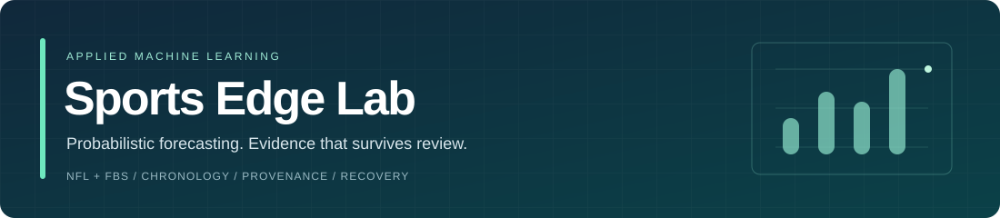
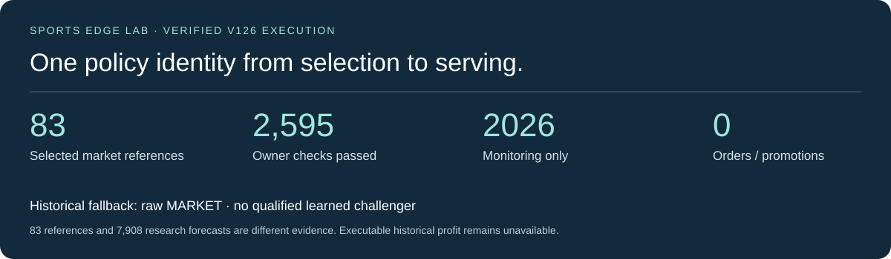

<p align="center"></p>

NFL and FBS forecasting built around a difficult engineering question: can a model add information beyond the market, and can every result survive an audit?

Designed and implemented by [Alvaro Mendizabal](https://github.com/alvaromendizabal). The project connects source acquisition, information-time contracts, native ML frameworks, chronological experiments, immutable forecasts and recoverable AWS execution. NFL, FBS, NBA and NCAA basketball maintain separate model evaluations while sharing provenance, recovery and data infrastructure.

[Results dashboard](docs/dashboard/index.html) · [Start the review](docs/REVIEW_GUIDE.md) · [Current explorer](docs/current/index.html) · [Current evidence](docs/CURRENT_EVIDENCE.md) · [Model card](docs/MODEL_CARD_CURRENT.md) · [System design](docs/SYSTEM_DESIGN.md) · [Run the example](examples/review_lab/README.md)

Latest completed football execution, October 28: [V134 completed all twelve registered extension fits in twelve attempts](docs/evidence/2026-10-28-v134-execution.json), restored financial reporting, and verified every declared emitted stage output. The combined study now contains 36 completed units across 38 attempts, preserving both earlier failures. All four extension qualification gates failed; the operational policy remains MARKET.

V134 issued 89 timestamped MARKET references, covering all 68 remaining current-week games. Its edge-qualified portfolio retained $500 as cash, with zero qualified executions, fills or orders. Inherited conditional +$2.40 still equals MARKET and is not realized profit. [The completion study](docs/V134_COMPLETION_AND_SHARED_INVENTORY.md) connects the [earlier V133 recovery failure](docs/PORTABLE_RECOVERY_INCIDENT.md), the verified correction and measured throughput costs. The [dashboard](docs/dashboard/index.html) preserves earlier scorecards under their original vintages. A new [shared-inventory example](examples/review_lab/shared_inventory.py) deduplicates three invented project scopes without turning missing inventory into permission to buy data. V135 owner execution remains pending.

The new [recoverable operations example](docs/RECOVERABLE_OPERATIONS.md) persists eight independent stage contracts on invented inputs. It preserves forecasts and financial artifacts when research fails, retries only unfinished work, rejects changed identities and corrupt receipts, and reenters with zero new stage attempts after completion.

Earlier completed football research, V129: [V129 completed 24 constrained ensemble fits and passed 2,856 owner checks](docs/evidence/2026-10-28-v129-execution.json). Independent saved-output rescoring verified 2,046 probability scorecards and 32 matched MARKET intervals. All four historical league/protocol qualification gates failed, so operational forecasts retain the sportsbook MARKET fallback. The [new study note](docs/CONSTRAINED_ENSEMBLE_FINDINGS.md) explains the small NFL 2024 gain, the 2025 reversal and why training safeguards did not establish heldout superiority. No promotion, order or realized profit is claimed.

The [retained V125 aggregate export](docs/evidence/2026-10-27-v125.json) preserves 9,756 model scorecard views, 180 paired expert comparisons and 1,586 venue diagnostics. Counts describe aggregate records, not unique games or independent tests.
The new [historical-selection contract](docs/HISTORICAL_SELECTION_BOUNDARY.md) reserves 2026–2027 for monitoring. Current-season outcomes cannot choose a champion, calibration method, feature set, ensemble or staking policy. The public example demonstrates how that boundary survives a forward-season apparent winner and how a frozen, outcome-free paper decision is settled separately.

<p align="center"></p>

Basketball status, October 27: B003 completed controlled opponent-adjustment experiments with 60 new native estimator units and 156 exact predecessor reuses, bringing the cumulative basketball total to 232. Rich regularized models improved both college historical seasons; NBA retained its previous strength model. Larger matched sportsbook cohorts still establish no qualified MARKET advantage. The [basketball study](docs/BASKETBALL_FOUNDATION.md), [generated league leaderboards](docs/BASKETBALL_RESULTS.md), [model card](docs/BASKETBALL_MODEL_CARD.md) and [executed notebook](notebooks/basketball_review.ipynb) expose both gains and calibration weaknesses. Prior forecasts remain immutable; all 61 upcoming games still lack settled prospective scores at the audited snapshot. B001's failure is preserved. [B004 subsequently executed and stopped at the public-request ceiling](docs/BASKETBALL_B004_EXECUTION.md): six new correction units bring basketball to 238, with no promoted challenger. B003 remains the latest fully completed real modeling release. B005 subsequently completed zero-fit evidence recovery. The [new MARKET-coverage study](docs/BASKETBALL_MARKET_COVERAGE.md) and [executed cohort notebook](notebooks/basketball_market_coverage.ipynb) correct the pooled-season comparison: baseline-probability matching leaves the NCAA men gap, while month-aware matching reduces it with substantial uncovered-support loss. This descriptive result establishes no independent MARKET advantage or new budget authority. B006 has now completed authenticated saved-evidence analysis with zero new fits. The [basketball evidence dashboard](docs/basketball/index.html) exposes 235 saved scorecards, historical overlap and monitoring boundaries; the [feature-release contract](docs/BASKETBALL_FEATURE_RELEASE.md) and [executed notebook](notebooks/basketball_feature_release.ipynb) demonstrate cutoff-safe revisions and immutable feature snapshots on invented data.

B007 completed authenticated saved-evidence recovery with zero new fits, requests or forecasts. [B008 then executed and returned BLOCKED_DATA_CONTRACT](docs/BASKETBALL_B008_EXECUTION.md): zero new fits, zero paid requests or provider credits, and 110 additional immutable forecast versions for the same 61 games. The archive now contains 440 versions, none settled; cumulative real basketball units remain 238. A shared preflight prevented eligible folds from being reached, while incomplete archive inventory blocked acquisition. The [B009 continuation example](examples/basketball_contracts/continuation.py) isolates support failures, retains the original authorization and counter baseline, and keeps unresolved request charges across restart. The [recovery contract](docs/HISTORICAL_ODDS_RECOVERY.md) now attaches inventory, request and response provenance to every gap. These invented examples make no requests or fits; B009 owner execution remains pending.

## A five-minute technical review

| Inspect | What it demonstrates |
|---|---|
| [Shared archive federation](docs/V134_COMPLETION_AND_SHARED_INVENTORY.md) | Complete declared scope, byte and semantic deduplication, original request receipts, cutoff admission and no implicit spend authority |
| [Recoverable operations journal](docs/RECOVERABLE_OPERATIONS.md) | Atomic immutable receipts, input/dependency identity, bounded attempts, interrupted-publication recovery and zero-work reentry |
| [Results and execution dashboard](docs/dashboard/index.html) | Actual failure, exact historical panels, monitoring vintage and an interactive fault-isolation demonstration |
| [Credential-free ML example](examples/review_lab/README.md) | Real fitting on invented data, chronological separation, exact-cohort scoring and zero-fit reentry |
| [Executed review notebook](notebooks/engineering_review.ipynb) | Synthetic mechanisms beside separately validated owner-run aggregates and actual V126 serving lineage |
| [Exact-panel explorer](docs/current/index.html) | 57 league / protocol / origin / target panels, full model filters, points and distribution metrics |
| [Historical-selection guard](examples/review_lab/historical_selection.py) | Forward-outcome rejection, evidence clocks, matched panels and immutable selection identity |
| [Serving-lineage contract](examples/review_lab/serving_lineage.py) | The same historical policy identity in selection, serving and ledger; typed clocks and honest row accounting |
| [Paper-decision ledger](examples/review_lab/decision_replay.py) | Pregame-only selection, explicit native league weeks, price/depth/fee constraints and separate settlement |
| [Portfolio evidence boundary](docs/PORTFOLIO_EVIDENCE.md) | Persisted commitment before settlement, explicit unavailable profit and one budget across mutually exclusive venue scenarios |
| [Numerical recovery and partial work](docs/NUMERICAL_RECOVERY_INCIDENT.md) | Independent convex certificates, bounded invented recovery and no double-counting imported work |
| [Transactional prospective state](docs/PROSPECTIVE_STATE_MACHINE.md) | Append-only decisions and settlement, atomic native-week capital reservation, immutable reentry, source clocks and unavailable unsettled profit |
| [Selection-to-decision case study](docs/CASE_STUDY_SELECTION_TO_DECISION.md) | Why a successful expert run and favorable isolated score do not establish a trading edge |
| [Basketball study and public checks](docs/BASKETBALL_FOUNDATION.md) | Audited real season aggregates, separate league leaderboards and executable identity/time contracts using invented fixtures |
| [Basketball continuation case study](docs/BASKETBALL_B008_EXECUTION.md) | Actual blocked research, independent forecast output, inherited authority and isolated support failures |
| [Historical odds recovery contract](docs/HISTORICAL_ODDS_RECOVERY.md) | Content-verified cache reuse, cutoff-safe recovery batches, bounded credit plans and durable reservations on invented data |
| [System design](docs/SYSTEM_DESIGN.md) | Data/model/decision contracts, lineage, failure states and recovery |
| [Published scientific implementations](docs/PROJECT_SCOPE.md) | Preserved fitting, acquisition, uncertainty and interruption tests from earlier research stages |

Open the self-contained HTML explorer locally; GitHub's file viewer displays source. It makes no external requests. Historical minimums are emphasized only within one exact cohort, protocol and origin. The 2026 view uses stable model identifiers and never ranks, highlights or promotes by current-season outcome. Filtering models does not redefine the historical comparison winner.

## What the completed run established

| V126 owner result | Verified outcome |
|---|---|
| Execution | SUCCESS; zero new fits and zero new fit attempts |
| Owner verification | 2,595 checks passed across four workers |
| Measured worker time | 450.646 seconds; peak process-tree RSS 4.12 GB |
| Retained work | 456 native cells, six fusion fits and 20 expert fits reused |
| Historical selection | No learned qualifier; raw MARKET fallback for each league |
| Serving identity | 83 market references bind to the same frozen historical selection |
| Research output | 7,908 research forecast rows remain separately classified |
| Financial evidence | Historical profit unavailable; no strict eligible replay established |
| Orders and promotion | Zero actual orders and zero automatic promotions |

The [serving-lineage case study](docs/CASE_STUDY_SERVING_LINEAGE.md) connects the correction to an executable public invariant. The [conditional-expert study](docs/CASE_STUDY_SELECTION_TO_DECISION.md) preserves V125's negative historical result. The [earlier factorial study](docs/CASE_STUDY_JOINT_EVIDENCE.md) tests complementarity; the [joint-score study](docs/CASE_STUDY_SCORE_DISTRIBUTIONS.md) separates coherent distributions from improved forecasts. The completed V127 residual study adds a further negative qualification result: all eight primary historical season/protocol comparisons have Holm-adjusted p-values of 1.0. Its 2026 panels are monitoring only, with no model ranking or promotion.

## Market comparisons without invented profit

Raw MARKET is archived bookmaker consensus after paired de-vig. A fitted MARKET-only model is a separate learned baseline. Kalshi and Polymarket US are separate venue diagnostics, with contract-specific payout targets and execution requirements.

| 2026 monitoring archive | NFL games | FBS games |
|---|---:|---:|
| Kalshi intersection | 77 | 177 |
| Polymarket US intersection | 59 | 272 |
| Both venues | 59 | 174 |

These are intersection counts, not completed-wager counts. NFL midpoint comparisons remain conditional-non-tie proxies. A historical quote does not establish an available ask, depth, correct fees, a fill or a contract-aligned payoff. Historical net profit remains unavailable. The illustrative public ledger permits unspent cash, rejects invalid execution evidence, and never accepts outcomes during selection.

## Engineering decisions worth inspecting

- Preserve publication, observation, revision, label-availability, model-availability and decision clocks.
- Fit preprocessing and learned representations within chronological training boundaries.
- Compare complete systems, their interactions and retained controls on the same games.
- Separate historical qualification from forward monitoring; exposed evidence cannot become untouched evidence by relabelling it.
- Bind forecasts and decisions to content identities; settle immutable decisions without rerunning selection.
- Distinguish a valid probability target, a predictive score improvement and executable economic value.
- Preserve accepted work through bounded recovery and report negative results directly.

## Reproduce the public review

Python 3.11+; no credentials or cloud account are required for the standard-library example. Run from the repository root:

```bash
python -m unittest discover -s examples/review_lab/tests -v
python -m examples.review_lab --output /tmp/sports-edge-review
python -m examples.review_lab --output /tmp/sports-edge-review
python -m examples.review_lab.build_review --check
python -m examples.review_lab.build_current_review --check
python -m examples.review_lab.provenance
python -m examples.review_lab.factorial
python -m examples.review_lab.distribution
python -m examples.review_lab.historical_selection
python -m examples.review_lab.decision_replay
python -m examples.review_lab.serving_lineage
python -m examples.review_lab.portfolio_evidence
python -m examples.review_lab.prospective_state
python -m examples.review_lab.numerical_recovery
python -m examples.review_lab.fault_isolation
python -m examples.review_lab.recoverable_stages
python -m examples.review_lab.build_status_dashboard --check
node examples/review_lab/tests/test_dashboard.cjs
node examples/review_lab/tests/test_selectors.cjs
node examples/review_lab/tests/test_current_selectors.cjs
```

The second fitting invocation verifies and reuses the accepted synthetic report with zero new fits. A changed seed, implementation or artifact is rejected. Selection and decision examples use invented data and illustrative rules; they do not expose the private football recipe or place orders. Optional notebook execution uses pinned Jupyter dependencies; see [reproduction instructions](examples/review_lab/README.md).

The public-review workflow runs Python 3.11/3.12 checks, deterministic generated-page checks, selector semantics and a separate-kernel notebook job. It preserves [scientific modeling](.github/workflows/modeling-quality.yml), [acquisition guards](.github/workflows/ingestion-guards.yml) and [repository hygiene](.github/workflows/repository-hygiene.yml) workflows. Local validation and hosted Actions are separate evidence; consult the Actions result for the exact published commit.

## Public code, private research assets

Public material includes evaluation mechanisms, synthetic fitting, tests, notebooks, architecture and sanitized aggregate research results. Licensed/raw observations, individual forecasts, production weights, active feature transformations, exact tuning and live decision configuration remain private. Public examples verify engineering behavior and do not reproduce private football training.

[Publication boundary](docs/PUBLICATION_BOUNDARY.md) · [Historical evidence and maintained paths](docs/PROJECT_SCOPE.md) · [Repository review](docs/REPOSITORY_REVIEW.md) · [Dated V120 explorer](docs/review/index.html)


