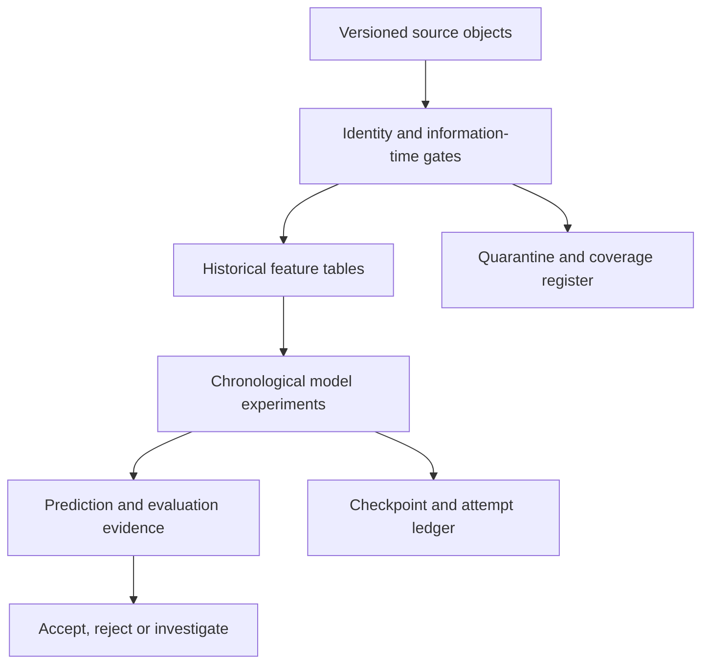

> Historical architecture lineage. The [current system design](SYSTEM_DESIGN.md) explains the completed V118 serving path and its remaining readiness limits. Earlier stage statements below remain dated.

# Architecture and execution contracts

[Project overview](../README.md) · [Data readiness](DATA_READINESS.md) · [Model card](MODEL_CARD.md)

Sports Edge Lab separates acquisition, validity, forecasting and decision evaluation. A successful download establishes only the first of those states. AWS is the authoritative execution and data environment; GitHub contains the reviewable implementation and sanitized evidence.

## Data plane

| Layer | Persisted evidence | Required invariant |
| --- | --- | --- |
| Raw sources | Source identifier, request parameters, object hash/size, observed timestamp, usage conditions | Preserve received bytes and distinguish revisions. |
| Identity | Canonical game, team and player mappings; join counts; ambiguity reasons | Exact unique matches or explicit unresolved state. Names are display fields. |
| Temporal features | Source lineage, event/release assumptions, decision cutoff, feature schema | Construct the target's features before incorporating its outcome. |
| Model fit | Input/config/environment fingerprint, training fold, seed, fitted parameters | Training-only preprocessing; no silent reuse across incompatible configurations. |
| Predictions | Target, game, model, decision horizon and fold | Compare identical cohorts and disclose information-horizon differences. |
| Evaluation | Proper scores, residuals, slices, paired uncertainty and gate decision | No promotion from a favorable isolated metric or exposed test alone. |

Canonical paths separate sport-specific `tracks/` archives from shared acquisition and modeling evidence. The canonical bucket and role remain unchanged. Credentials are resolved only in the authorized AWS environment; no credential material belongs in this repository or a return bundle.

## Information time

Event time, source publication, first observation, revision, assumed label availability and prediction decision time are separate fields. Archived rows may contain revisions published after the historical event. A date filter alone does not establish a point-in-time dataset.

V057 uses an explicit retrospective assumption: prior-game information becomes available 24 hours after kickoff and must precede a target decision 24 hours before kickoff. This prevents direct target-game inclusion under the assumption. It does **not** verify unknown original publication timestamps. The selected QB is the last observed dominant passer, never a retrospectively discovered target-game starter.

## Execution lifecycle

1. Validate the self-contained Python archive, imports, environment, offline unit/fixture behavior and notebook support before credentials or network access.
2. Verify AWS identity and canonical scope, source hashes, schemas and work budgets.
3. Reuse only compatible successful checkpoints. Reserve each real fit attempt before training; missing or inconsistent usage evidence fails closed.
4. Emit stage progress and heartbeats with elapsed time, remaining work, resource state and an explicitly assumed cost estimate.
5. Save predictions, metrics, model cards, diagnostic notebook and one unique compact return ZIP on success or a classified failure/stop.
6. Inspect the returned evidence before accepting a result. Re-entry preserves a completed return and does not silently refit.

Local preparation uses synthetic tests, schema inspection and mocked cloud behavior. Real model fitting executes in the owner's AWS environment. Current CPU experiments require no GPU. Runtime costs, idle Studio costs, storage, requests and provider subscription usage are separate categories.

## Failure and safety boundaries

| Failure | Behavior |
| --- | --- |
| Missing/corrupt input or mismatched hash | Stop before fitting; retain a diagnostic return. |
| Invalid entity or denominator | Quarantine or fail according to the declared contract; never fabricate a match. |
| Temporal leakage or target inclusion | Fail the data gate. |
| Interrupted fit queue | Resume compatible checkpoints within the original attempt budget. |
| Provider denial or ambiguous shared budget | Stop that provider; do not bypass rate limits or reset evidence. |
| Concurrent run / incompatible state | Reject overlap or unsafe reuse. |
| Failed experiment | Record a valid negative result when execution and evaluation are correct. |
| Favorable retrospective result | Require the predeclared comparison gates, then a separate prospective trial; no automatic production promotion. |

Existing acquisition collectors and schedules have their own frozen scope. Cache-only modeling does not restart them. Closing a process does not stop a Studio application or its billing.

## Public reproducibility boundary

[V059 state/repair core](../modeling/football_v059/README.md) and [V058 benchmark implementation](../modeling/football_v058/README.md) expose the experiment mechanics. The V059 public tests/demonstration use synthetic data; its owner execution completed separately, with 16 verified real fits. Code, tests, contracts, source references and non-sensitive aggregate metrics are reviewable here. Exact owner results require access to the pinned AWS objects and their applicable source rights. Synthetic fixtures establish software behavior, not achieved real-data model performance. Large raw files, private/licensed records, model binaries and secrets stay outside public Git history.

## V059 joint-state extension: completed

V059 kept acquisition separate from modeling. It validated FBS-versus-FBS scope and a cached regulation-drive repair, preserving frozen features and labels. Static/dynamic Gaussian team filters then consume only declared released results. Both arms update their posterior after earlier outcomes become available; the static control has zero process drift rather than no learning. Each joint fit produces home/away means and covariance, then win, margin and total outputs.

The public core reports Gaussian density/CRPS, native interval diagnostics and negative-score mass as explicit model assumptions. The actual return completed 16 fits and eight FBS repairs, with no model promotions. Point-only accepted baselines do not acquire a joint density by comparison. [Runtime evidence](status/football_v059/summary.json) is distinct from public fixture outputs.

## V060 reporting boundary: acquisition, representation and frozen inputs

V060's actual run completed 84 native/linear fits and finite source capture. All 14 selected official pages were received; ten passed secondary-source validation and four remained rejected. Six changed NFL files were downloaded, with four semantic changes. These data are staged separately from frozen model features.

The return inherited stale top-level readiness counters from an earlier version. The [explicit errata](status/football_v060/readiness_errata.json) preserves the original report and names authoritative current sources for calls, coverage and freshness. Counts are now separated into original-provider gaps, captured sources, validated secondary games, frozen prediction rows and current finals. A report field must not override a newer, verified capture ledger merely because it is labeled readiness.

## V061 public feature boundary and completed owner outcome

The [minimal situation-method core](../modeling/football_v061/README.md) contains feature construction, shared normalization and synthetic tests only. It adds 36 historical situation columns to the 16 baseline columns and has no collector, credentials or model fitter. Its 23 checks verify identity, denominators and temporal isolation; they do not establish improved football performance.

The owner workflow completed 24 NFL fits with no qualified candidate and validated two cached historical records, bringing secondary coverage to 12/14. Its current 15-game capture stopped on the first robots HTTP 403, with zero summaries captured. The persisted host denial is retained. [Actual outcome](status/football_v061/README.md) is separate from the preserved public-method preparation receipt.

## V062 boundary: prepared objective comparison and independent sources

V062 prepares 16 LightGBM L1 margin/total fits against three cached references. Exact frozen input hashes, feature order, target cohorts, timestamps, package version, original seeds 6001 and all non-objective settings must match V060. No reference or win model is refitted. The outputs are conditional medians, not expected points or probabilities.

The source queue separately names 17 FBS-versus-FBS official-school targets. Fourteen HTML pages permit at most 14 validated drive closures; three PDF captures yield text only. Forty total HTTP attempts / 100 MB, one-second host spacing, exact game validation and durable provider stops bound execution. ESPN and paid-provider calls are zero. New data does not enter the frozen comparison. [Prepared contract](status/football_v062/README.md); no runtime result is claimed.
