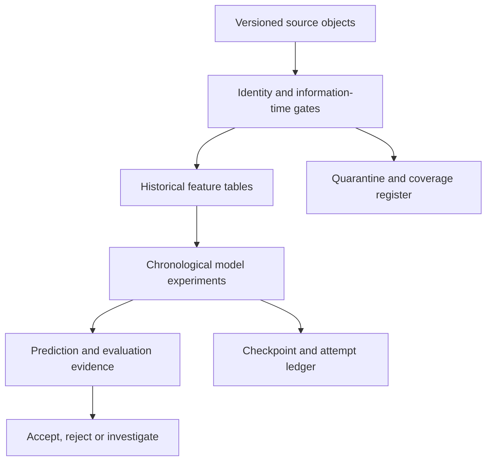

# Architecture and execution contracts

[Project overview](../README.md) · [Data readiness](DATA_READINESS.md) · [Model card](MODEL_CARD.md)

Sports Edge Lab separates acquisition, validity, forecasting and decision evaluation. A successful download establishes only the first of those states. AWS is the authoritative execution and data environment; GitHub contains the reviewable implementation and sanitized evidence.

## Data plane

| Layer | Persisted evidence | Required invariant |
| --- | --- | --- |
| Raw sources | Source identifier, request parameters, object hash/size, observed timestamp, usage conditions | Preserve received bytes and distinguish revisions. |
| Identity | Canonical game, team and player mappings; join counts; ambiguity reasons | Exact unique matches or explicit unresolved state. Names are display fields. |
| Temporal features | Source lineage, event/release assumptions, decision cutoff, feature schema | Construct the target's features before incorporating its outcome. |
| Model fit | Input/config/environment fingerprint, training fold, seed, fitted parameters | Training-only preprocessing; no silent reuse across incompatible configurations. |
| Predictions | Target, game, model, decision horizon and fold | Compare identical cohorts and disclose information-horizon differences. |
| Evaluation | Proper scores, residuals, slices, paired uncertainty and gate decision | No promotion from a favorable isolated metric or exposed test alone. |

Canonical paths separate sport-specific `tracks/` archives from shared acquisition and modeling evidence. The canonical bucket and role remain unchanged. Credentials are resolved only in the authorized AWS environment; no credential material belongs in this repository or a return bundle.

## Information time

Event time, source publication, first observation, revision, assumed label availability and prediction decision time are separate fields. Archived rows may contain revisions published after the historical event. A date filter alone does not establish a point-in-time dataset.

V057 uses an explicit retrospective assumption: prior-game information becomes available 24 hours after kickoff and must precede a target decision 24 hours before kickoff. This prevents direct target-game inclusion under the assumption. It does **not** verify unknown original publication timestamps. The selected QB is the last observed dominant passer, never a retrospectively discovered target-game starter.

## Execution lifecycle

1. Validate the self-contained Python archive, imports, environment, offline unit/fixture behavior and notebook support before credentials or network access.
2. Verify AWS identity and canonical scope, source hashes, schemas and work budgets.
3. Reuse only compatible successful checkpoints. Reserve each real fit attempt before training; missing or inconsistent usage evidence fails closed.
4. Emit stage progress and heartbeats with elapsed time, remaining work, resource state and an explicitly assumed cost estimate.
5. Save predictions, metrics, model cards, diagnostic notebook and one unique compact return ZIP on success or a classified failure/stop.
6. Inspect the returned evidence before accepting a result. Re-entry preserves a completed return and does not silently refit.

Local preparation uses synthetic tests, schema inspection and mocked cloud behavior. Real model fitting executes in the owner's AWS environment. Current CPU experiments require no GPU. Runtime costs, idle Studio costs, storage, requests and provider subscription usage are separate categories.

## Failure and safety boundaries

| Failure | Behavior |
| --- | --- |
| Missing/corrupt input or mismatched hash | Stop before fitting; retain a diagnostic return. |
| Invalid entity or denominator | Quarantine or fail according to the declared contract; never fabricate a match. |
| Temporal leakage or target inclusion | Fail the data gate. |
| Interrupted fit queue | Resume compatible checkpoints within the original attempt budget. |
| Provider denial or ambiguous shared budget | Stop that provider; do not bypass rate limits or reset evidence. |
| Concurrent run / incompatible state | Reject overlap or unsafe reuse. |
| Failed experiment | Record a valid negative result when execution and evaluation are correct. |
| Favorable retrospective result | Require the predeclared comparison gates, then a separate prospective trial; no automatic production promotion. |

Existing acquisition collectors and schedules have their own frozen scope. Cache-only modeling does not restart them. Closing a process does not stop a Studio application or its billing.

## Public reproducibility boundary

[V058 public implementation and fixture instructions](../modeling/football_v058/README.md) expose the experiment mechanics. Code, tests, contracts, source references and non-sensitive aggregate metrics are reviewable here. Exact owner results require access to the pinned AWS objects and their applicable source rights. Synthetic fixtures establish software behavior, not achieved real-data model performance. Large raw files, private/licensed records, model binaries and secrets stay outside public Git history.
