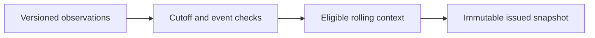

# Basketball feature engineering starts with availability

A historical value can be correct and still be unavailable to a pregame model. This public example makes that distinction executable: it constructs rolling team context from invented observations, chooses only revisions known at the cutoff, excludes the target game's outcome and preserves an issued feature snapshot when the archive later changes.

The [interactive basketball evidence dashboard](basketball/index.html) presents the real aggregate research record separately. The [executed feature notebook](../notebooks/basketball_feature_release.ipynb) uses invented teams, scores and clocks for its engineering demonstration. Neither the example nor a passing test authenticates a real source's original publication time.

## One record, several clocks

The demonstration retains event completion, original publication, local observation and revision identity. Strict eligibility requires an asserted verified original clock and both publication and observation at or before the cutoff. The verification flag in this fixture is a caller assertion: a production system would need independently checked provenance supporting it.

| Invented case | Correct pregame behavior |
|---|---|
| A result published and observed before cutoff | Admit the known revision to rolling context |
| A correction released after cutoff | Keep the earlier revision for the issued snapshot |
| A claimed old publication first observed after cutoff | Exclude it; backdating cannot erase the observation clock |
| An observation without a qualified original publication clock | Exclude it from strict timing |
| A named reconstructed 24-hour research protocol | Apply its lag and observation constraint; keep it labeled research |
| The target game's outcome, even with an earlier claimed timestamp | Exclude it by event identity |
| No eligible team history | Return explicit missing history and null summaries, not invented zeros |
| A duplicate source revision with conflicting values | Reject the input rather than silently choose a row |

The small feature vector contains rolling points for/against, observed prior-game count, elapsed time from the last completed game and the latest evidence-availability clock. These are generic examples, not the private basketball feature transformations. Evidence recency is not a proxy for complete player availability, lineup readiness or fresh information for every feature.



The snapshot content identity binds the exact request, eligible revisions and resulting feature values. Adding future or otherwise excluded records changes diagnostic counts but leaves that identity unchanged. A newly eligible correction cannot overwrite an already issued snapshot; it requires a distinct issuance context. Exact repeated input is verified reuse, not another fit or forecast execution.

## What B006 actually completed

The [authenticated B006 recovery record](evidence/2026-10-28-basketball-b006-recovery.json) confirms completed saved historical analysis with zero real fits, inference, external requests, new forecasts or orders. It verified 128 return pins, 423 embedded-source pins and 222 inherited native references without loading models. All 330 forecast versions in 18 files across 61 games remain intact. There was no new settlement check and no expanded monitoring panel.

B003 remains the latest fully completed modeling release. B004 remains stopped; B005 and B006 are two completed evidence-recovery runs. The cumulative real-unit count is still 238. The 493 source tests belong to B006's local preparation, not a new owner test run; its returned notebook was inherited, not newly executed by B006.

The maximum measured active floor is 4,263.755538637 seconds. A still-open finalization reservation extends to 4,443.755538637 seconds; that reservation is not measured spent time. Conservative remaining work is 56.244461363 seconds, below the unchanged 60-second admission guard. An exact matching closed live receipt is needed to reconcile the reservation before another useful owner batch can proceed. Source requests are 48/48. No extra compute, training, paid requests or real-money activity is authorized.

## Why this matters for new model families

Dynamic team strength, opponent context and player representations all depend on this information boundary. A more expressive estimator cannot repair a late observation, a retrospective revision or an unsupported pregame player join. The public contract demonstrates the integration boundary using invented data; it does not expose the private dynamic-strength kernel or claim a real trained result.

The existing [MARKET coverage investigation](BASKETBALL_MARKET_COVERAGE.md) also illustrates a different boundary: missing sportsbook observations cannot establish model advantage. Probability-only matching leaves the NCAA men discrepancy, while month-aware matching reduces it and discards substantial uncovered support. The dashboard displays exact comparison populations rather than silently pooling these views.

Current 2027 outcomes remain monitoring-only. Dashboard monitoring rows have no winner highlighting or model-selection order. Historical numerical minima are descriptive within their exact cohort and do not imply statistical superiority, promotion, executable prices or profit. Sportsbook MARKET remains separate from Kalshi, Polymarket US and international Polymarket.

## Reproduce the public contract

```bash
python -m examples.basketball_contracts.feature_release
python -m unittest discover -s examples/basketball_contracts/tests -v
python -m examples.basketball_contracts.build_basketball_dashboard --check
node examples/basketball_contracts/tests/test_dashboard.cjs
python -m examples.basketball_contracts.execute_feature_notebook --output /tmp/basketball-feature-release.ipynb
```

The dashboard is a self-contained HTML artifact: open it locally to use the league, horizon, season and cohort controls. GitHub's file viewer displays source. The dashboard makes no external requests and the standard-library example requires no credentials. Notebook execution uses the repository's pinned public Jupyter dependencies.

The portfolio assessment remains 8.5/10 before and after this update. Availability contracts, an inspectable dashboard and reproducible notebook improve engineering evidence. They do not substitute for untouched predictive validation, authentic early MARKET training support or independent trading evidence.
