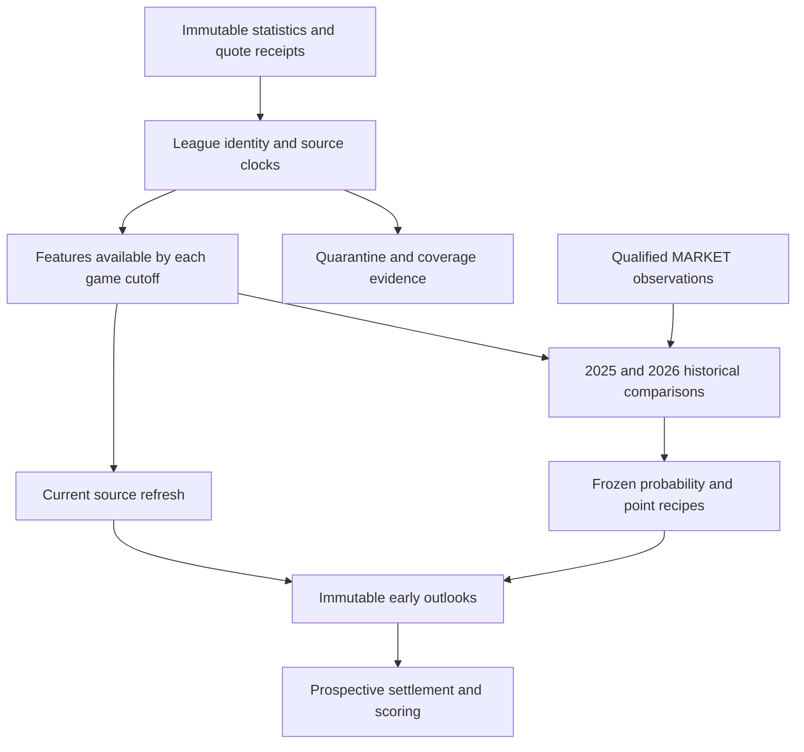

# Basketball: first historical models, with MARKET advantage unresolved

[Project](../README.md) · [Model card](BASKETBALL_MODEL_CARD.md) · [League leaderboards](BASKETBALL_RESULTS.md) · [Aggregate export](evidence/2026-10-27-basketball-b002.json) · [Executed notebook](../notebooks/basketball_review.ipynb) · [Public contracts](../examples/basketball_contracts/README.md)

B002 completed the first real NBA, NCAA men's and NCAA women's historical evaluations on October 27, 2026, Pacific time. The audited return contains 172 completed native estimator units, six reconstructed research tracks and timestamped early outlooks for 61 upcoming games. It establishes a functioning research pipeline. It does not establish an advantage over MARKET or profitable wagering.

B001 remains a recorded failed execution. A nullable schedule season reached MARKET identity construction before its validity check; modeling never started. B002 corrected that boundary, canonical score-column compatibility, upstream box quarantine enforcement and a historical NBA calendar exception. The successful successor reused verified source receipts while carrying the earlier resource charges forward.

## What actually completed

| League | T−60 native fit units | T−24h native fit units | Full-cohort probability selection | Distinct early-outlook games |
|---|---:|---:|---|---:|
| NBA | 33 | 21 | Regularized strength model | 41 |
| NCAA men | 38 | 21 | Regularized combined basketball model | 8 |
| NCAA women | 35 | 24 | Regularized combined basketball model | 12 |

The 172 units consist of 64 classifiers, 64 calibrators and 44 margin/total score estimators. Fit counts describe completed computation, not independent experiments or predictive gains. Eight distinct estimators were reused within the run and are not counted again. All completed native weights, checkpoint signatures and 64 frozen bundles passed the return audit. No model arm or league stage failed.

The owner software gate passed 287 tests. The returned research notebook saved four executed code cells and two native inline Plotly outputs, then reopened and passed its later-cell check. These software checks are separate from the actual model evaluations in the aggregate export.

## Historical result, by validation season

These are the full basketball cohort results for the historically selected T−60 probability recipe. Training ended in 2024 for validation in 2025 and ended in 2025 for validation in 2026. The table does not mix in MARKET's much smaller matched cohorts.

| League | Season ending | Games | Log loss ↓ | Brier ↓ | Accuracy | Correct / incorrect | Fixed-bin calibration error ↓ |
|---|---:|---:|---:|---:|---:|---:|---:|
| NBA | 2025 | 1,248 | 0.612542 | 0.212630 | 64.98% | 811 / 437 | 0.030820 |
| NBA | 2026 | 1,249 | 0.602398 | 0.207240 | 67.73% | 846 / 403 | 0.030582 |
| NCAA men | 2025 | 5,758 | 0.530652 | 0.179246 | 72.20% | 4,157 / 1,601 | 0.014187 |
| NCAA men | 2026 | 5,749 | 0.533493 | 0.180642 | 71.68% | 4,121 / 1,628 | 0.020576 |
| NCAA women | 2025 | 5,280 | 0.462930 | 0.153622 | 76.44% | 4,036 / 1,244 | 0.016230 |
| NCAA women | 2026 | 5,621 | 0.467299 | 0.155838 | 75.84% | 4,263 / 1,358 | 0.023989 |

The [full league leaderboards](BASKETBALL_RESULTS.md) retain historical priors, Elo, strength, style, combined models and all three native boosting libraries. NBA's strength model had the lowest pooled historical log loss; the combined regularized representation led both college cohorts. Those are selected descriptive results on development folds. They are not untouched confirmations or evidence that the same ranking will persist prospectively.

Point forecasts use separate regularized Ridge margin and total regressors. In particular, a score selection carrying a CatBoost classification recipe label does not mean a CatBoost point regressor was trained. The model card and public tables identify the point estimator directly.

## MARKET remains the unresolved comparison

| League | T−60 matched games: 2025 / 2026 | T−24h matched games: 2025 / 2026 | Conclusion |
|---|---:|---:|---|
| NBA | 7 / 6 | 38 / 30 | No qualified model advantage |
| NCAA men | 0 / 118 | 0 / 69 | Incomplete historical support; no qualified advantage |
| NCAA women | 23 / 13 | 2 / 2 | Small and unstable comparison cohorts; no qualified advantage |

On the 118 NCAA men's T−60 matched games in 2026, the style model's log loss was 0.557273 versus raw MARKET's 0.563326. The paired difference was −0.006053 with a descriptive 95% seven-day-block interval of [−0.041032, 0.035094]. Thirteen blocks and the missing 2025 comparison do not support promotion. NBA and women's matched results likewise do not establish stable superiority.

The learned MARKET-only and integrated basketball-plus-MARKET arms were declared but blocked by inadequate eligible training history. They must not appear as successfully trained models. A correctly bound archived event is not automatically a fresh, cutoff-qualified training example. B003 is planned to address bounded cache enumeration and source coverage before revisiting this comparison.

## Source and information-time contract

The three leagues have separate native identity namespaces. Source publication, observation, revision and retrieval clocks remain distinct. The adopted statistical sources do not establish original historical publication times, so B002's completed tracks use an explicitly reconstructed 24-hour release assumption. A frozen 48-hour input-delay sensitivity is reported separately. No strict historically observed basketball validation track was admitted.

Coverage denominators are provider-covered eligible schedules, not certified complete league universes. Historical NBA box records with inconsistent rebound definitions remain unavailable for advanced box features; trustworthy outcomes can still support score histories. NCAA membership and opponent eligibility are labeled research proxies until stronger official coverage is established. Men's and women's source completeness is assessed separately.

Player availability, projected rotations, lineup combinations, transfer continuity, dynamic Bayesian hierarchies, graph encoders, PyTorch/TensorFlow architectures and distributional score laws remain future work for basketball. Method names alone do not establish implemented or evaluated capability.

## Current issuance and operational evidence

B002 issued 110 forecast rows across 61 distinct upcoming games. All were recorded before their game and model/input clocks passed the issuance checks. Every row was an early outlook before its declared T−60 or T−24h lock. None had a qualified fresh MARKET probability; all remained NO_BET. There were zero paid acquisitions and zero actual orders. No forecasted game had settled at issue, so prospective accuracy, proper scores and profit were unavailable. The 52 completed current-season NBA games in the return were retrospective monitoring, not a prospective track record.

The owner execution took approximately 28.6 active minutes through the return snapshot. Cumulative work including B001 was 37.3 minutes under the existing 75-minute ceiling. The 172 estimator fits used about 58.5 seconds; repeated feature preparation and final rebuilds accounted for about 22 minutes. B003's planned efficiency work therefore targets validated reuse and feature preparation. Increasing fit parallelism alone would address a much smaller share of runtime.

## Public reproduction and next decision

The [public notebook](../notebooks/basketball_review.ipynb) reads only the committed aggregate export, renders the selected season tables and a figure, and runs the invented contract walkthrough in a separate section. It fits no basketball model. The [evidence validator](../examples/basketball_contracts/evidence.py) checks accounting, protected-season boundaries and comparison cohort identities without loading private data or weights. CI tests both the public example and saved notebook behavior.

B003 owner execution is pending. Its planned work covers cached MARKET recovery, exact reusable-work validation, feature preparation efficiency and prospective monitoring. The next scientific decision is whether adequate matched historical data allows learned MARKET-only and integrated models to improve both historical folds. New source rows, faster code or more fits alone will not establish that result.

The [publication boundary](PUBLICATION_BOUNDARY.md) preserves private source observations, active feature formulas, fitted assets, account/object paths and individual forecasts. The public aggregate export makes the outcome reviewable; full private-model retraining is not available from this repository alone.
