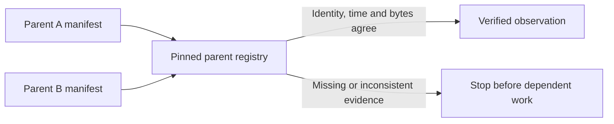

# Case study: when passing tests missed a recovery topology

[Project](../README.md) · [Runnable example](../examples/review_lab/README.md) · [Executed notebook](../notebooks/engineering_review.ipynb) · [Execution receipt](evidence/2026-10-26-execution.json)

V119 passed 1,058 owner checks and its separate-kernel notebook gate, then stopped during `PUBLIC_DATA_REPAIR`, at retained-source admission and before public refresh or real fitting. A retained source belonged to a verified predecessor that was absent from the resolver's declared parent scope. The resolver correctly refused that source; the orchestration supplied an incomplete relationship between otherwise verified artifacts.

The run produced zero real fits, zero new forecasts and zero wagers. The registered modeling hypothesis remains unevaluated. Earlier model scores did not change. This is an engineering failure with a bounded impact, not a successful experiment with a negative scientific result.

## The contract that matters

A filesystem path describes where a copy lives. It does not establish the copy's identity, authority or information availability. Recovery needs a stable logical reference, an explicitly admitted parent, a pinned manifest and exact content verification. The accepted source clock must survive relocation.

The public demonstration uses two invented parent bundles with the same relative filename but different content. It relocates both bundles, deliberately omits one parent from admission, reproduces the rejection, then admits both exact manifests and recovers their verified bytes. Changing one byte afterward still fails. No search across arbitrary directories or weakening of the containment rule is needed.

## What the new tests exercise

| Scenario | Expected behavior | Why it matters |
|---|---|---|
| Valid bundle moved to a new declared root | Accept identical content and preserve the observation clock | Storage location should not become model or data identity |
| Two parents contain the same relative key | Resolve by parent identity plus key | Basenames are not globally unique identifiers |
| Referenced parent omitted from admission | Stop even if a matching file exists nearby | Recovery must not silently enlarge the trusted source scope |
| Parent or manifest identity differs | Reject | A plausible filename is not provenance |
| Member changes after parent admission | Reject by byte count and digest | Verifying a manifest alone does not verify its current members |
| Member path traversal, member symbolic link or duplicate key | Reject | Ambiguous or escaping references are not valid source contracts |
| Observation is at or after the decision | Reject | Relocation must not make future information eligible |
| Caller reads a verified observation | Return the verified bytes | Avoid a second unverified file read by downstream code |

The example assumes immutable local cache ownership. It is not a security sandbox for a hostile process changing directories concurrently, a remote object-store client, or a full transaction manager. These boundaries are explicit in the source.

## What changed in the verification strategy

The earlier suite checked individual recovery pieces but missed the actual multi-parent composition. The additional fixture therefore preserves the important shape of the failure: more than one verified predecessor, a retained input from the second predecessor, relocation, admission and downstream read in one flow. Mutation cases check that the repair does not make unknown parents, changed bytes or changed clocks acceptable.

The [public module](../examples/review_lab/provenance.py) is a deliberately separate, standard-library implementation using invented observations. It explains and tests the engineering mechanism without exposing active feature formulas, forecasts, fitted models, licensed observations or private execution layout. The private correction needs its own exact-artifact tests and a subsequent owner execution.

## Review questions

1. Does the admitted parent inventory match every source that the downstream step needs?
2. Is the same logical source still pinned after moving its local copy?
3. Does the system reject an incomplete recovery without fitting or overwriting accepted work?
4. Are source observation time, copy time and model availability kept separate?
5. Does the final report distinguish preflight success, run completion and model qualification?

The [notebook](../notebooks/engineering_review.ipynb) executes the synthetic failure/recovery flow beside the dated owner-run status. Both remain separate from the unchanged real-football aggregate scorecard.
