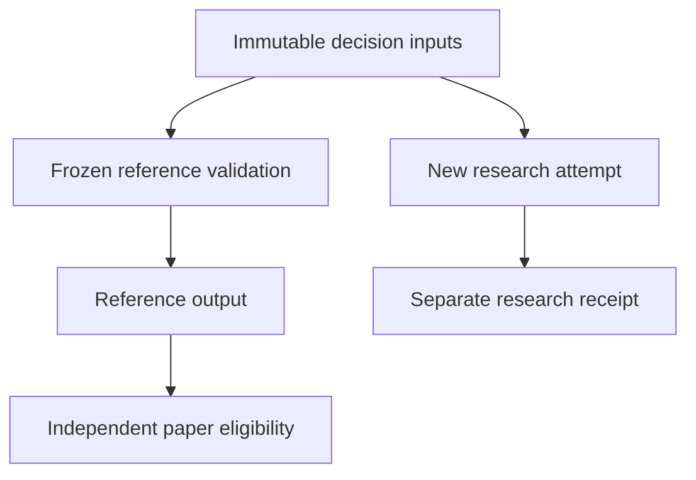

# Research failure and reference serving are separate decisions

[Dashboard](dashboard/index.html) · [Executable example](../examples/review_lab/fault_isolation.py) · [Tests](../examples/review_lab/tests/test_fault_isolation.py) · [Actual V131 owner aggregate](evidence/2026-10-28-v131-execution.json)

V131's actual failure prevented serving and paper stages from being reached. It produced no fresh forecasts. The public demonstration implements a different control flow on invented data: capture an ordinary research exception, then independently validate and serve a frozen reference policy. This is an engineering mechanism, not a claim that V132 has succeeded on the owner environment.



There is deliberately no research-success dependency before reference validation. The implementation snapshots the policy and reference rows before invoking research; a callback cannot replace those inputs by mutating the caller's objects. It exposes only an exception type, avoiding accidental publication of exception messages. It preserves research failure even when invented serving succeeds.

Reference admission requires a recognized frozen policy, valid probability, unique game, explicit UTC clocks, an observation no later than the decision, a bounded freshness window and a future kickoff. Outcome fields are rejected. Admission is atomic for this small demonstration: any invalid row blocks the complete fixture slate. The ten-minute window is invented and is not the private serving policy.

The serving output is explicitly classified `SYNTHETIC_MARKET_REFERENCE`, has no learned edge and binds the policy digest. The downstream demonstration remains `NOT_ELIGIBLE`: it contains no independent model advantage or executable venue evidence. Paper stake is zero; profit is unavailable. There is no order interface.

| Scenario | Research | Synthetic reference serving | Paper readiness |
|---|---|---|---|
| Research exception, valid fixture | Failed | Served | Not eligible |
| Research completion, same fixture | Completed | Identical served output | Not eligible |
| Research exception, stale observation | Failed | Blocked | Not eligible |
| Research exception, future observation | Failed | Blocked | Not eligible |

This is ordinary exception isolation in one process. `SystemExit`, process death, memory exhaustion, external storage errors and operating-system failures need separate supervision and durable checkpoints; this demonstration makes no claim to handle them. Real acquisition and current forecasts are not reproduced publicly.

## Dashboard evidence contract

The generated dashboard has 30 aggregate rows: 20 V131 partial historical FBS rows, eight prior V129 annual historical comparison rows and two prior V129 monitoring rows. League, season, protocol and evidence release must all match. Historical rows may emphasize the numerical minimum within that exact panel. Monitoring rows have stable order and no winner styling. No panel is fabricated when a combination is unavailable.

The 2026 monitoring view is a retained V129 snapshot, not a refreshed V131 or V132 result. V131 did not produce new monitoring. The compact export does not establish individual forecast issue timestamps. Older historical research has been repeatedly exposed; a descriptive confidence interval is not the complete multiple-comparison qualification family. V131's new challengers lose to MARKET on both proper scores in each available FBS panel; full two-league qualification remains incomplete.

The actual owner status cards remain independent: research `FAILED`, serving `NOT_REACHED`, paper execution `NOT_REACHED`. The synthetic section uses a separate dark panel, repeated invented labels and a different timestamp. This avoids substituting a UI demonstration for real scientific or operational evidence.

## Reproduce and verify

Run from the repository root with Python 3.11+ and Node:

```bash
python -m unittest discover -s examples/review_lab/tests -v
python -m examples.review_lab.fault_isolation
python -m examples.review_lab.build_status_dashboard --check
node examples/review_lab/tests/test_dashboard.cjs
```

The generator reads only the two sanitized public aggregate files and executes the four invented scenarios. It produces a self-contained page with no external requests. Selector checks exercise all 48 filter states and four scenario buttons, including missing panels and monitoring restrictions. Hosted Chromium checks render desktop/mobile layouts, exercise actual UI events, reject script errors and verify that the page makes no external requests. Separate notebook execution preserves rich outputs and final-cell completion.

Runtime and memory shown in the dashboard are measured V131 owner values. They are not throughput estimates, scalability benchmarks or V132 forecasts. Public data excludes private game observations, individual football predictions, component identities, parameters, paid data, source paths and credentials. The editorial assessment remains 8.94/10; this is an internal judgment, not external certification.
