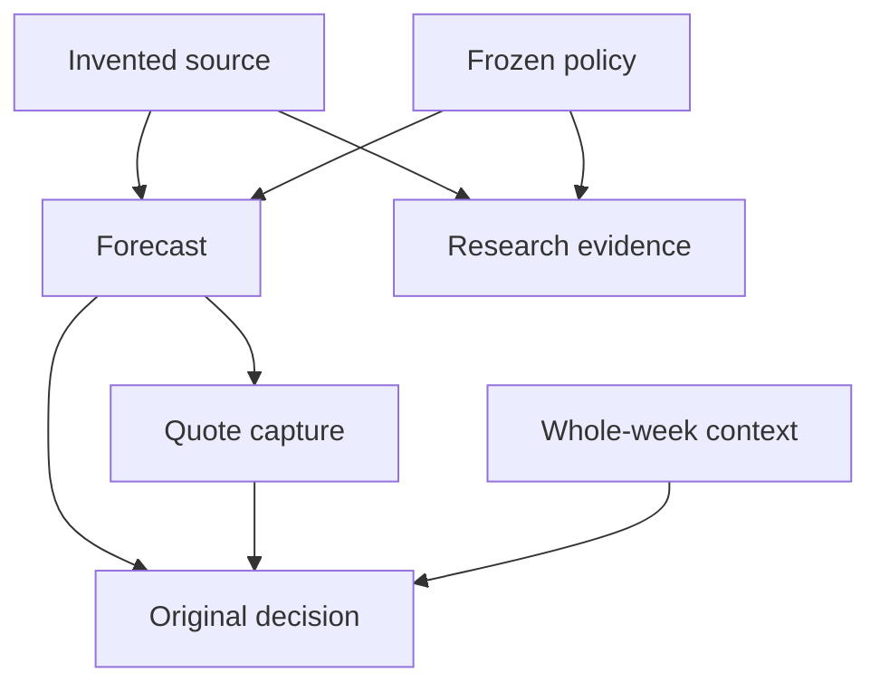

# A completed stage must also be recoverable

[Project](../README.md) · [Dashboard](dashboard/index.html) · [Sanitized owner receipt](evidence/2026-10-28-v133-execution.json) · [Executable example](../examples/review_lab/portable_recovery.py) · [Tests](../examples/review_lab/tests/test_portable_recovery.py)

V133 passed 3,095 owner tests, including all four mandatory notebook checks, then failed in paper-portfolio recovery. It issued 82 timestamped MARKET-reference games and saved market captures. None of the twelve new research units was attempted, and the financial report did not complete. The failed run therefore provides no result for or against the new scientific hypothesis.

## What failed

A selective parent import omitted an original readiness context containing whole-week decision locks. The paper adapter rebuilt an already committed issue with an empty lock mapping. That changed the decision's meaning. The append-only original-proof guard rejected it, as it should. When the full original context is present, the rebuilt issue matches apart from release provenance that was already treated separately.

Removing the equality check or treating the missing locks as harmless transport metadata would weaken the evidence. The required repair preserves the authenticated original issue, embedded whole-week context, policy and member proofs. Missing original context cannot silently become an empty candidate universe. New release and file-location metadata belong in a separate import receipt.

The tests had established useful local invariants, but had not reproduced this selective cross-release import. A passing test suite was not evidence that every returned checkpoint contained all of its dependencies.

## The return archive exposed a second boundary

An independent audit compared each completed stage receipt with the actual V133 return. Every available pinned member matched; the archive omitted some receipt dependencies.

| Stage | Receipt dependencies | Present and verified | Missing from return | Return-only closure |
|---|---:|---:|---:|---|
| Data integrity | 335 | 322 | 13 | Incomplete |
| Forecasts | 2,453 | 148 | 2,305 | Incomplete |
| Venue capture | 380 | 380 | 0 | Complete |

These are file counts, not games or independently collected observations. Missing return members may still exist in the owner workspace or authenticated parents. Their absence does not show that the on-host stage never completed; it shows that its receipt alone cannot establish portable recovery. Preserved forecast rows still provide inspectable output evidence even when all upstream dependencies are not in the return.

The next owner run must validate its available dependency closure, reuse only verified unchanged work, and retain original issue times. A recovery copy is not a fresh forecast. V134 actual execution remains pending; this document does not claim the private repair has already succeeded on AWS.

## Run the public mechanism

```bash
python -m examples.review_lab.portable_recovery
python -m unittest examples.review_lab.tests.test_portable_recovery -v
```

The standard-library example uses invented files and an explicit dependency graph. It makes no requests, fits no real models, submits no orders and reports no profit.



The walkthrough deliberately removes whole-week context from a sparse copy. Forecast and research dependencies remain ready, while the financial closure is blocked. An attempted reconstruction with empty locks is rejected against the original decision commitment. The exact original decision can still be inspected through its caller-held hash and embedded context; that does not falsely mark the missing external dependency as restored.

A complete export traverses the selected stages' transitive dependencies, validates paths, rejects symlinks and cycles, checks byte lengths and hashes, enforces a total payload limit, writes into a staging directory, verifies the copy, and publishes the bundle only after the closure passes. Reopening that bundle reproduces the original forecast clock and decision bytes. Release provenance is recorded separately and does not mutate either.

The example distinguishes a wholly ready bundle from an explicitly selected ready subset. Exporting research alone cannot label the financial stage recoverable. Export limits reject incomplete publication rather than dropping required files until a package fits.

## Trust and execution limits

- The caller supplies the expected manifest and original-decision hashes. A hash stored beside its own payload is not external authentication, a trusted historical clock or evidence of source availability.
- The manifest declares the dependency graph. This example validates that declaration and its files; it cannot discover a dependency the producer failed to declare.
- The files and destination are a trusted, quiescent local workspace. Path/symlink checks are not a security boundary against concurrent hostile replacement. Immutable publication assumes no competing writer to the destination.
- The example uses file synchronization and a final directory rename. It models ordinary process interruption and rejects incomplete output; it does not promise power-loss recovery on every filesystem or implement distributed storage transactions.
- Decision identity preservation does not validate a real staking policy, contract mapping, exchange fee, fill, settlement or profitable edge. The invented original decision is explicitly hypothetical and unqualified.
- Stage readiness is a dependency check, not a claim that a callback ran. The existing [stage journal](RECOVERABLE_OPERATIONS.md) separately demonstrates bounded execution and reentry.

## Scientific and financial status

The completed V132 study remains the latest evidence for the original family: 24 accepted units across 26 attempts, with all four historical qualification gates failed. The V133 twelve-unit extension remains untested. It is inappropriate to call an unexecuted hypothesis a modeling failure or select a different approach using 2026 outcomes.

The latest completed financial report remains V132. Its conditional +$2.40 equals the MARKET control and does not establish executable or realized profit. V133's failed financial stage does not create a new validated allocation or cash balance. The public dashboard keeps these releases and evidence types separate.
