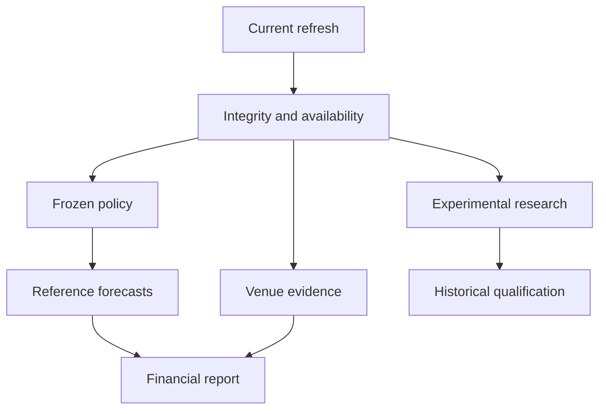

# Recoverable work without changing the frozen policy

[Dashboard](dashboard/index.html) · [Executable journal](../examples/review_lab/recoverable_stages.py) · [Tests](../examples/review_lab/tests/test_recoverable_stages.py) · [Actual V132 aggregate](evidence/2026-10-28-v132-execution.json)

V132 actually completed the full registered study and issued 83 MARKET-reference games before remaining research. All four predictive qualification gates still failed. Financial reporting completed with zero qualified executions. Those are separate owner results; the implementation below demonstrates the engineering boundary with invented data and real temporary files.



The dependency graph permits independent work; this small implementation runs sequentially and makes no parallel throughput claim. Research cannot rewrite an already accepted frozen policy, forecast or financial artifact. A completed numerical stage does not imply predictive qualification; the invented qualifier explicitly returns false.

## What survives a failure

A scope binds canonical input bytes, the declared stage recipes, dependency order and attempt limit. Each stage binds exact dependency outputs. Before a callback, the journal flushes an immutable attempt reservation. It writes a complete terminal receipt through a temporary file and an atomic create-only link, then publishes the accepted receipt. Successful receipts are never overwritten. Failed attempts retain their type without exporting potentially sensitive exception text.

On reentry, the journal verifies scope, reservation sequence, terminal receipt shape, dependency identity and output digest. Completed stages return their original output without invoking their callbacks. A successful terminal event whose acceptance publication was interrupted can restore its accepted receipt with zero new execution. An interrupted reservation without a terminal success consumes an attempt; it is not counted as accepted work. Attempts after completion, changed scope, missing proof of success and corrupt outputs fail closed.

| Invented invocation | New stage attempts | Reused stages | Research | Forecast / finance |
|---|---:|---:|---|---|
| First | 7 | 0 | Failed; qualification blocked | Accepted before research |
| Resume | 2 | 6 | Research + qualification execute | Original identities retained |
| Unchanged reentry | 0 | 8 | Reused | Original identities retained |

These are stage counts, not estimator-fit counts or real football work. The fixture's integrity and quote callbacks are deliberately invented contract outputs; they do not verify a real data provider. The separate [reference admission example](FAULT_ISOLATION.md) exercises probability and timestamp rejection. Both examples have no order API, no executable venue quote and no learned-model advantage.

## Reliability limits are explicit

The exclusive local writer lock prevents concurrent journal writers. It is never stolen automatically: a process-kill may leave a stale lock, requiring operator inspection. This is a trusted single-host filesystem example, not a distributed scheduler. File contents are flushed before atomic publication, but it does not claim universal power-loss durability across filesystems or remote mounts. Content digests detect accidental corruption; they are not signatures and do not protect against an attacker who can rewrite all receipts. Recipe identifiers are declared contracts, not automatic attestation of callback implementation or external state.

`SystemExit` and process termination are not swallowed as scientific failures. Previously accepted files remain on disk. The public example makes no production orchestration or V133 owner-success claim.

## Reproduce

```bash
python -m examples.review_lab.recoverable_stages
python -m unittest examples.review_lab.tests.test_recoverable_stages -v
python -m examples.review_lab.build_status_dashboard --check
node examples/review_lab/tests/test_dashboard.cjs
```

The dashboard embeds the actual output of three fresh invented journal invocations. Its execution selector shows stage status, new work and content identity; it never presents synthetic probabilities as current football forecasts. Hosted Chromium checks the new controls on desktop and mobile. The notebook executes and reopens rich outputs.

The public V132 export contains 50 whitelisted aggregate scorecards and measured owner status. Model internals, raw/paid observations, individual forecasts, private source hashes and active configuration are excluded. Historical data remain repeatedly exposed; 2026 scores are reconstructed post-freeze monitoring and cannot select a model. The editorial assessment remains 8.94/10.


## Subsequent V133 portability failure

The actual V133 owner run later failed during paper-proof import, after fresh reference serving but before new research. An omitted original context changed whole-week decision locks; the immutable proof guard correctly rejected it. Some completed stage receipts also referred to dependencies absent from the returned ZIP. See the [incident and portable-closure example](PORTABLE_RECOVERY_INCIDENT.md). The successful synthetic journal above does not prove that the private return was complete.
