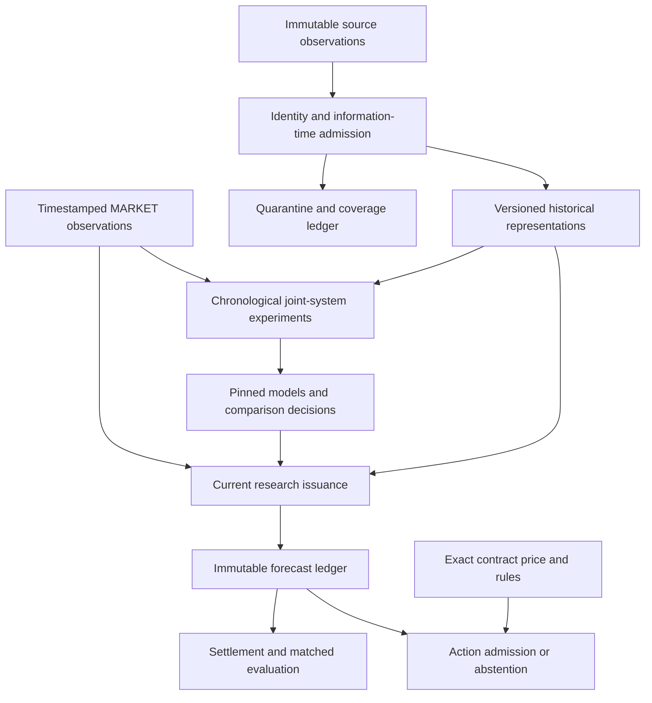

## Verified selection-to-serving boundary

V126 demonstrated the historical policy binding in the owner environment. The selected policy identity, actual serving rule and authoritative native-week ledger share one frozen selection digest. A forecast with a different rule hash or later selection clock remains separate research evidence. Benchmark references and learned forecasts have separate counters. See the [case study](CASE_STUDY_SERVING_LINEAGE.md), [public verifier](../examples/review_lab/serving_lineage.py) and [sanitized receipt](evidence/2026-10-27-v126-execution.json).

Elapsed performance stages are operational measurements; publication, first observation, selection availability and issue times are evidence clocks. Neither is substituted for the other. Passing lineage checks does not qualify a learned policy or a contract edge.

# System design — explicit selection and decision boundaries

[Overview](../README.md) · [Selection contract](HISTORICAL_SELECTION_BOUNDARY.md) · [Case study](CASE_STUDY_SELECTION_TO_DECISION.md)

The latest public extension separates four records: historical qualification, forward monitoring, pregame paper decision and settlement. Historical qualification fixes candidates, protocols, cohorts and evidence clocks. Forward monitoring verifies that frozen identity without choosing a new winner. The paper decision consumes outcome-free evidence under a precommitted rule and native league week. Settlement attaches realized unit payoffs without rerunning selection.

These records complement source provenance and model lineage. A valid source join does not establish historical publication time; a valid forecast does not establish a qualified selection; a model edge does not establish an executable fill. Content identities and explicit failure reasons connect these layers while preserving their distinct evidence requirements.

Public implementations are standard-library educational mechanisms with invented examples. Private football recipes and operational credentials are excluded. See the [publication boundary](PUBLICATION_BOUNDARY.md).

## Preserved architecture detail

# From source observations to auditable forecasts

[Project](../README.md) · [Current evidence](CURRENT_EVIDENCE.md) · [Model card](MODEL_CARD_CURRENT.md)

Sports Edge Lab treats a forecast as a versioned claim about a specific event at a specific information horizon. Data validity, model validity and action validity are separate checks.

## Three independent contracts

| Contract | Required evidence | Failure behavior |
|---|---|---|
| Data | Canonical event/team identity, source bytes, publication/observation/revision clocks, accepted schema and support | Quarantine or stop; no invented joins or backdated observations |
| Model | Training-only learned transforms, chronological origin, exact input schema, model/config identity and availability | Reject incompatible reuse or a model unavailable at the decision |
| Decision | Eligible immutable forecast, exact target/contract mapping, fresh source anchor and execution quote, fees and settlement rules | Abstain and record the reason |

These contracts allow research forecasts to exist while action gates remain closed. V118 is an example: saved models issued current probabilities, while stale sportsbook inputs prevented action admission.

## Training and serving

The private research bank includes regularized linear baselines, native gradient-boosted trees and neural models implemented in LightGBM, XGBoost, PyTorch and TensorFlow. Experiments compare complete football-plus-MARKET systems, matched representation controls and retained references. Football features span history, play/possession context, opponent adjustment, recency and information support. The current public export discloses aggregate outcomes rather than exact active transformations.

Chronological fitting controls when labels and learned source models become available. Historical retrospective release assumptions are labeled as assumptions; they do not certify unknown publication times. Current serving additionally checks actual observed/model availability. A recovered file path cannot change the model's identity or first availability.

The current serving path prepares expensive football representations before its final source capture and price-dependent prediction. The recorded final-read-to-issue interval fell from 245.440 seconds in an earlier execution to 6.282 seconds in V118. This is an observational comparison across different paths, not a controlled latency benchmark. Source freshness remains separate from computation latency.

## A recoverable execution

1. Check archive integrity, environment selection, native dependencies, synthetic behavior and notebook persistence.
2. Confirm canonical owner scope and pinned input identities.
3. Reserve bounded work and reuse only compatible completed artifacts.
4. Record progress, elapsed time, process-tree memory, disk and cost assumptions.
5. Preserve current probabilities and their actual issue time.
6. Produce one return on success, classified failure or bounded stop.
7. Verify accepted reentry without another fit or changed forecast.

Resource limits protect the execution; they are not evidence of a model improvement. A successful negative experiment is retained as successful execution with a rejected scientific hypothesis.

## Explicit trade-offs

| Decision | Benefit | Remaining limitation |
|---|---|---|
| Use MARKET as a strong reference and model input | Tests incremental information beyond public pricing | Requires validated, timely MARKET inputs; consensus is not a trade price |
| Preserve incumbent models | Prevents a newer version from silently replacing a stronger system | Selected historical leaders still need independent prospective evidence |
| Keep raw revisions immutable | Enables identity and temporal audits | Unknown original publication times remain a historical limitation |
| Reuse saved models for current serving | Avoids redundant training and preserves provenance | Frozen learned representations do not automatically absorb every newly collected row |
| Publish synthetic code and aggregate evidence | Supports review without exposing restricted assets | Does not permit full private-model retraining |

[Earlier architecture notes](ARCHITECTURE.md) remain dated lineage. [Maintained source paths](PROJECT_SCOPE.md) explain which public components run independently.
