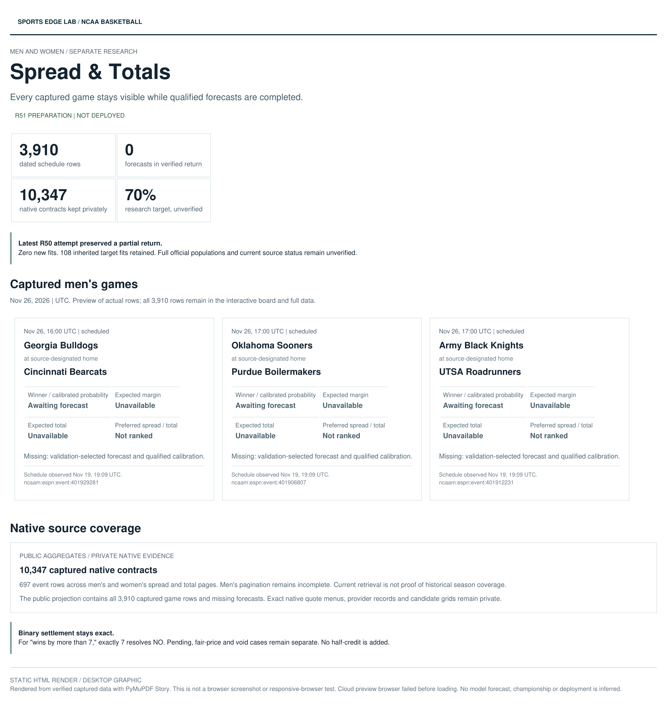

# NCAA Spread & Totals — November 26, 2026 preparation snapshot

[All captured games and source coverage](spread_totals.html) · [Saved summary](spread_totals_latest.json) · [Rendering and data checks](spread_totals_verification.json)

The latest verified R50 owner invocation ended with a preserved partial return after an S3 conditional-write failure. It completed **zero new fits** and produced **no current forecast artifacts**. The return retained 108 historical target fits; preservation is separate from newly verifying or refitting them. This R51 preparation report keeps that failure visible while the replacement executable is prepared separately.

This update adds a dated **3,910-game** inventory: **1,964 men's games and 1,946 women's games**. It retains all observed rows and leaves winner, calibrated win probability, signed margin, total and preferred sides unavailable wherever no qualified forecast exists. The schedule's dates span November 1–December 8, 2026. Its newest row observation is November 25 at 04:21:26 UTC; many upcoming rows were observed earlier. These are saved source statuses, not a live schedule refresh or proof of a complete official population. Postseason completeness remains unproved.

## Market evidence and exact settlement

The private preparation evidence contains **10,347 native Kalshi contracts across 697 captured event rows**, observed around November 26 at 00:29:38 UTC. Men's spread and total retrievals each retained 200 event rows with a remaining pagination cursor. Women's retrievals retained 145 spread and 152 total event rows with no remaining cursor for those requests. These counts describe the returned pages; they do not establish historical requested-season coverage, complete native strike menus at every horizon or qualified game-to-contract joins.

The public board includes aggregate coverage. Raw native quote menus, provider records, candidate prediction grids, active recipes and execution packages remain private under the repository's [NCAA publication boundary](../PUBLICATION_BOUNDARY.md#selected-ncaa-basketball-all-game-research-outputs-november-11-extension).

The preparation implements exact binary predicates. For a proposition stating “wins by more than 7,” a margin of exactly 7 makes the proposition false. Normal YES and NO probabilities complement one another. Pending, void and fair-price outcomes remain separate from normal binary grading. Current official [spread terms](https://assets.kalshi.com/contract_terms/BASKETBALLSPREADS.pdf) and [total terms](https://assets.kalshi.com/contract_terms/BASKETBALLTOTALS.pdf) were retrieved and pinned for the private preparation. Current terms and prices cannot establish historical availability retrospectively.

## Scientific limits

Men and women retain separate evaluations and champion registries. Validation is 2024–25 and 2025–26; the frozen test season is 2026–27. The primary seasonal scoring weights are 50/50, with 40/60, 30/70, 20/80 and 10/90 sensitivity scoring from the same predictions. Changing evaluation weights does not refit an estimator or reweight its training rows. Previously exposed test results retain their exposure labels.

The **70% Spread & Totals target is not established**. There are no qualified Spread & Totals champions or current test metrics in this snapshot. Required evidence still includes official full populations, historical source rights and as-of qualification, chronological training and calibration, complete native horizon menus, and validation-selected per-objective champions. Correlated alternate strikes must not be counted as independent games. Displaying an observed schedule row or a source count does not complete any of these research gates.

## Rendering and publication

The HTML embeds all 3,910 observed game rows and supports men's/women's, date, status and text filters. Its JavaScript passed syntax checking, and the compressed embedded data was decoded and compared in full with the exact public projection. No synthetic forecast was added.

The phone and desktop graphics below were rendered from the actual sanitized data with **PyMuPDF Story** and visually inspected. They are static HTML renders. They are not browser screenshots or proof of responsive-browser behavior. The cloud preview browser failed before loading the page, so browser interaction and responsive-browser QA remain unverified. The static graphics show a small labeled preview; the HTML retains every captured row.

This is a source update to a draft PR. Source publication, scientific selection, owner execution, merge and website deployment remain separate. No owner run, new fit, model promotion, merge or live deployment is performed by this reporting update. Historical NCAA reports remain dated records of their earlier releases.

## Evidence identities

| Evidence | SHA-256 |
| --- | --- |
| Latest verified partial R50 return | `600dccf052520d966172f5ec45e8c39b562a76b8e8cb31eb0d0774da9c13d9c7` |
| Source used by that R50 return | `bbb9e6c8c58ab635dc25772e7530ef1f490f04d3e6b19c32a7387e161f7644f9` |
| Full retrieved game snapshot logical bytes | `8f9097708c6311ec1fab5975b09cc51a1b1f9142fd15e22491c2abc857f49c38` |
| Exact public projection | `ab971b39f13d7fff0ab6b637945db53b1f6dbb0fb48e834368eaa2eef7cc2837` |

These identities bind the observed evidence. They are not a claim that R51 has run or completed its scientific campaign.
