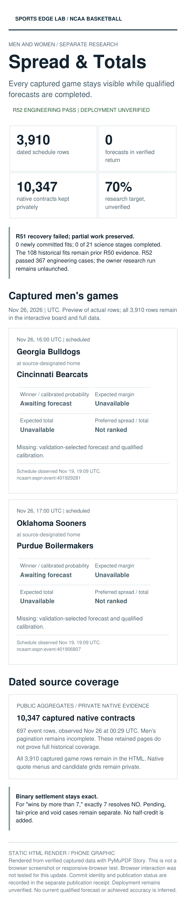

# NCAA Spread & Totals — R52 continuation, November 26, 2026

[All captured games and source coverage](spread_totals.html) · [Saved summary](spread_totals_latest.json) · [Rendering and data checks](spread_totals_verification.json)

This existing report pathname is retained for continuity with the six-file NCAA review surface. The update below supersedes its earlier R51 preparation status; it does not alter other projects.

## Actual latest owner result

The R51 invocation closed at **02:31:03 UTC on November 26** with `FAILED_PARTIAL_WORK_PRESERVED`. Historical import preparation rejected `V112_HISTORICAL_OPERATIONAL_BRIDGE_REQUIRED` before any of the 21 registered science-stage bodies completed. The full returned archive contains 327 SHA-256- and CRC-verified members. Archive integrity does not make the scientific execution successful.

The physical ledger establishes **zero newly committed estimator, calibration, residual or unclassified model artifacts** and **zero verified reused target fits in this invocation**. It does not establish that uncommitted estimation was impossible; unreported all-workstream totals remain unknown. No new full-population forecast was produced. The missing official population is not an empty population.

The **108 historical target fits** retained in prior R50 evidence remain historical evidence. They are neither new R51 fits nor 108 newly verified reuses in this failed invocation. The current failed return establishes no qualified Spread & Totals champion or current forecast for either the men's or women's cohort.

## R52 engineering qualification passed

R52 source-bound engineering qualification **passed 367 observed cases**: 362 startup cases and five witnesses. The full historical import consumer completed with pinned historical fixtures and without mocking source authentication. This is engineering evidence; it does not establish a qualified forecast, new scientific fit, current source coverage or production occupancy. No R52 owner research run has been launched by this preparation update. The finite **384-context base-validation wave remains planned work**, not a fit count. Additional prospective research branches remain explicitly deferred; their registration admits no extra current-run work. Native preparation checks, scientific fits, model promotion and deployment are separate results.

## Dated game and market evidence

The board preserves the same **3,910 captured game rows: 1,964 men's and 1,946 women's**. Their scheduled dates span November 1–December 8, 2026. The newest row observation is November 25 at 04:21:26 UTC; some rows were observed earlier. These are saved source statuses. This reporting update did not refresh the schedule or prove a complete official population or postseason census.

Winner, calibrated win probability, signed margin, total and preferred sides remain unavailable where no qualified forecast exists. No synthetic pick has been inserted. The phone and desktop graphics show a small, labeled preview; the HTML retains every captured row.

The private preparation evidence retains **10,347 native Kalshi contracts across 697 captured event rows**, observed around November 26 at 00:29:38 UTC. Men's spread and total requests each returned 200 event rows with a remaining cursor; women's requests returned 145 spread and 152 total event rows without a remaining cursor for those requests. These dated counts establish retrieval, not complete seasons, full strike menus at each horizon or qualified game-to-contract joins. This update makes no new source retrieval claim.

The public projection contains aggregate market coverage. Native quote menus, provider arrays, candidate grids, private recipes and execution archives remain private under the repository's [NCAA publication boundary](../PUBLICATION_BOUNDARY.md#selected-ncaa-basketball-all-game-research-outputs-november-11-extension).

## Scientific and settlement requirements

Men and women retain separate evaluations and champion registries. Validation is 2024–25 and 2025–26; the frozen test season is 2026–27. Primary evaluation weights are 50/50, with 40/60, 30/70, 20/80 and 10/90 sensitivity scoring from identical base predictions. Changing weights must not refit estimators or reweight training rows. Prior test exposure remains labeled.

The **70% Spread & Totals target is not established**. Official full populations, historical rights and as-of source qualification, chronological model and calibration fits, complete native horizon evidence, validation-selected champions and frozen test results remain missing. Correlated alternate strikes must not be counted as independent games.

For a proposition stating “wins by more than 7,” exactly 7 makes that statement false. Normal YES and NO probabilities complement one another; pending, void and fair-price settlements remain separate. Exact [spread terms](https://assets.kalshi.com/contract_terms/BASKETBALLSPREADS.pdf) and [total terms](https://assets.kalshi.com/contract_terms/BASKETBALLTOTALS.pdf) govern the underlying propositions. Current terms cannot establish historical availability retrospectively. There are no Circa outputs for NCAA.

## Rendering and publication

The HTML retains the existing layout and filters. The embedded compressed dataset is decoded and compared in full with the exact public projection. Its JavaScript receives a syntax check; that check does not establish browser execution. The phone and desktop graphics are static HTML renders made with **PyMuPDF Story**, not browser screenshots or responsive-browser tests. Their visual-review state is recorded in the separate verification file.

This is an engineering-qualified review artifact for the existing NCAA draft-PR surface. Its commit identity, source-publication status and remote file readbacks are recorded in the separate publication receipt. The branch was observed draft, open and unmerged on November 26, 2026 at 03:09:41 UTC; that dated observation does not identify a future commit. Deployment remains unverified. Source publication, owner research execution, merge and deployment retain separate evidence.

## Evidence identities

| Evidence | SHA-256 |
| --- | --- |
| Latest fully verified failed R51 return | `5ddcffad4e92a6ddea183c3e6e339ca9820d5ca9a84cb290e4bc7b34d9b6f9b7` |
| Exact source used by that R51 run | `d71b7344b888c7fcd9f4d68b5f8495ca995b86d57a09d6d4296224e15492c325` |
| Retained full game snapshot logical bytes | `8f9097708c6311ec1fab5975b09cc51a1b1f9142fd15e22491c2abc857f49c38` |
| Exact public projection | `36250c3c903d32a4eb46055de10576ab3f8b7228746f5658580bca57b7baad0d` |

R52 source SHA-256 is `68ad7f0d53bfb1e6fb83cf0a014e5959ac625d47e77e88933b29bde3d5ee18e3` (77508626 bytes). Its engineering acceptance SHA-256 is `7ac18aeb7515f46f1034412ff72305355024a190bee5c6e200e47b7910237a57` (139373 bytes). The four-core engineering reservation is separate from the owner's requested capacity and does not prove scientific throughput. These observations do not claim that R52 has completed its scientific campaign.
